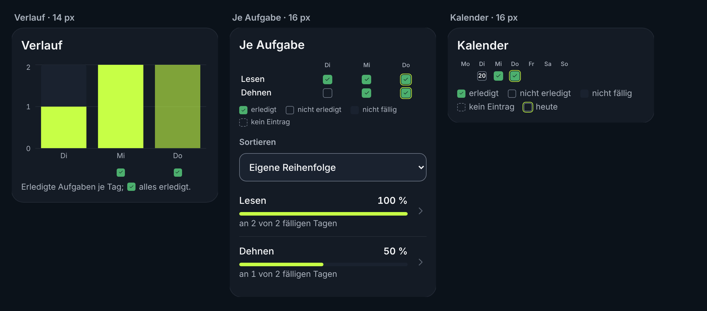

# Rebranding zu FORM – Bericht

Stand: 22.10.2026 · Branch `form-rebranding` (Basis `1891e68`, `main` nach PR #48) · Auftrag: `handover-form-rebranding.md`, `handover-markenassets.md`, `form-markenleitplanken.md`. Aufbau wie der Bericht der Audit-Phase A (`audit-report.md`).

Regeln: Jeder Screen, jede Funktion und jeder Datenfluss bleibt; die App bekommt den Look des FORM-Konzepts. Texte kommen aus den Leitplanken, nicht aus dem Konzeptbild. Keine Streak-, Serien- oder Challenge-Zähler. Dark ist Standard; helle Tokens werden nur angelegt. Ein Commit je Paket mit D-Nummer in `docs/decisions.md`; nach jedem Paket `pnpm check:bundle` und E2E (Chromium lokal, WebKit in GitHub Actions).

Nur Getestetes gilt als fertig; Testergebnisse stehen wörtlich in Abschnitt 3.

---

## 1. Pakete

| Paket | Inhalt | Entscheidung | Stand |
|---|---|---|---|
| F0 Platz im Startbündel | Nachladen statt mitliefern: Beschreibungshilfen aus Seiten in `calc`-Dateien, Trainingsdienst erst beim Start, `lazy`-Komponente für Übungseinstellungen, Texte nachgeladener Seiten in `de-nutrition.ts`, `de-sync.ts`, `de-program-editor.ts`; ungenutzter Block `motivation` entfernt | D-307 | umgesetzt, Startansicht 226,9 KB (vorher 249,6 KB) |
| F1 Tokens | FORM-Farben unter den bestehenden Token-Namen, Dunkel erzwungen, helle Tokens nur angelegt, keine Schatten und kein Glas, Label 13/500, tabellarische Ziffern; `brand-tokens.md` mit Zuordnung alt → neu, Kontrasten und Abweichungen; Einstellung „Darstellung“ entfällt | D-308, Q-23 | umgesetzt |
| A Icons und Manifest | Assets aus `form-app-assets.zip` unter `public/icons/`, `public/brand/`, `public/splash/`; Manifest „FORM“ mit Nacht-Farben und vier Icons; Favicon-Links; altes Hantel-Motiv und `pnpm icons` entfernt | D-309 | umgesetzt |
| B Kopfzeile | Kachel-F plus Wortmarke als `` (30 px, Tippfläche 44 px) auf jeder Seite, Seitenleiste mit Kachel-F bzw. Logo, Begrüßung nach Tageszeit ohne Uhr, `app.name` „FORM“ | D-310 | umgesetzt |
| Antworten des Produktinhabers | nur Dunkel (Q-23), Tab-Leiste mit Glas und Linse in FORM-Farben, breitenunabhängig bauen | D-311 bis D-313 | festgehalten |
| F2 Komponenten | Maße, Radien, Schrift, Breakpoints und Inhaltsbreite als Tokens; Knopf, Karte, Chip (neu), Ring, Balken, Tab-Leiste (Glas in FORM-Farben), Listenzeile, Eingabe (`field`), Sheet (Griff, wegwischbar), Toast, Leerzustand; Symbole mit 1,75 px; Gewicht 600 | D-314 | umgesetzt, Screenshots in `docs/screens/komponenten/` |
| F3 Screens | Heute, Training, aktives Workout, Abschluss, Übungsdetails, Ernährung, Fortschritt und Mehr in Aufbau und Hierarchie des Konzepts; nur vorhandene Daten, keine Platzhalter; neue Komponenten `Tabs` und `MuscleTags` | D-315 | umgesetzt, Screenshots in `docs/screens/` (werden mit E erneuert) |
| C Anmeldung und Über die App | Anmeldung mit `logo-anmeldung-dunkel.svg`, Claim „FORM YOURSELF.“ und Unterzeile als Text, Felder und Knöpfe aus F2, ohne Karte, Glas und Lichtflecken; die eigenen Tokens der Anmeldung entfallen; „Über die App“ mit dem Logo ohne Claim | D-316 | umgesetzt, Screenshots `docs/screens/anmeldung.png` und `ueber-die-app.png` |
| D Startbild | `apple-touch-startup-image` für 20 Bildschirmmaße von iPhone und iPad, je hochkant und quer: drei Bilder unverändert aus dem Markenpaket, 37 nach derselben Regel erzeugt (`tools/splash.mjs`); nicht im Vorab-Speicher des Service Workers; Manifest-Farben #0C1219 seit A | D-317 | umgesetzt; Kaltstart ohne weißen Blitz nur am Gerät prüfbar (T-IPH-M0 Schritt 5, steht aus) |
| F4 Texte | Mikrotexte aus den Leitplanken (Abschluss „… Das warst du.“, Leerzustände Fortschritt und Verlauf, Ruhetag, Schritte-Ziel); keine Serie mehr in der Auswertung der Tagesaufgaben, dafür „Diese Woche x von y“; neuer Anzeigename für Programm C (seit F5 „Winterprogramm 2026“, D-328); Datenschutztext richtiggestellt; automatische Wortfeld-Prüfung | D-318 | umgesetzt |
| G Rückkehr-Flow | Nach 14 Tagen ohne Eintrag einmal je Rückkehr das Blatt „Schön, dass du da bist.“ mit „Ein Spaziergang“, „Ein leichtes Training“ (Hinweis im Player) und „Nur reinschauen“; „Pause“ im Verlauf und im Fortschritt; Satz zum ersten Start | D-319 | umgesetzt; Push nach 21 Tagen entfällt (D-329) |
| E Token-Abgleich | `brand-tokens.md` final: Abgleich mit `brand.css`, Zuordnung alt → neu, nachgerechnete Kontraste, Abweichungen, offene Punkte; ungenutzte Tokens `--ink-2`, `--on-ink`, `--on-ink-muted` entfernt; Screenshots aller Screens und Komponenten erneuert; dieser Bericht | D-320 | umgesetzt |
| Übergabe Marken-Chat | Alle Screenshots auf einem Bild (`docs/screens/uebersicht.png`) und als Archiv (`docs/screens.zip`), erzeugt mit `tools/screens-overview.mjs` | D-321 | umgesetzt |
| F5 §1 Bedienelemente | Schalter reagieren auf einen Tipp auf den Schalter selbst (alle elf); widersprüchliche Klassen an Chips und Knöpfen durch Varianten ersetzt, Schutztest; Wochentage der Tagesaufgabe in einer Zeile innerhalb der Karte; Wochenziel mit dem gespeicherten Wert vorbelegt; „Als Tabelle“ bleibt nach Neuladen | D-322 | umgesetzt |
| F5 §2 Aktives Training | Kein Sprung nach dem Erledigen eines Satzes: Verschiebungen über dem aktiven Satz werden vor dem Zeichnen ausgeglichen, der nächste Satz steht unter Kopf und Pausenkarte; beim Tippen bewegt sich nichts. Kopf: „Programm · Woche“ klein, Titel nur der Trainingstag, einzeilig | D-323 | umgesetzt; Verhalten der iOS-Tastatur nur am Gerät prüfbar |
| F5 §3 Programme und Training | Neue Seiten beginnen oben, Zurück stellt die Liste wieder her; Etiketten der Programmkarten oben rechts, Titel bricht davor um, Chevron rechts mittig; „Bereit für dein Training?“ auf „Heute“ und „Training“ ohne Training und ohne Programm | D-324 | umgesetzt |
| F5 §4 Kopfzeile, Icons, Markierungen, Startbild | Kopfzeilen-Logo mit grüner Kachel, 28 px, dieselbe Kachel in der Seitenleiste; ein Regler-Symbol für „Tagesaufgaben“ und „Wochenziel“; Kalenderzellen 28 px, abgerundet, Lime-Rahmen dünn und nur heute; Erledigt-Kreis 20 px; Seitenende geprüft (kein Fehler, neuer Test); Startbild C3 in 40 Größen und eine gleiche Startfläche in der installierten App | D-325 | umgesetzt; Kaltstart nur am Gerät prüfbar (T-IPH-M0 Schritt 5) |
| F5 §5 Ernährung | Ring mit Abschnitten nach Makros (Eiweiß, Kohlenhydrate, Fett, ab 5 % nicht zugeordnete kcal in Grau), Karte „Gegessen“ wie in der bisherigen App, derselbe Ring auf „Heute“; Datumszeile „Heute · Do., 22. Okt.“ einzeilig; Hinweis „Bei mindestens einem Eintrag fehlen Angaben zu …“ mit richtiger Aufzählung; „Aktuelles Ziel“ ohne Datum | D-326 | umgesetzt |
| F5 §6 Fortschritt | Zeitraum-Auswahl in einer Zeile (Fortschritt, Körpergewicht, Übung, Wasser, Tagesaufgaben), die Chips teilen sich die Breite | D-327 | umgesetzt |
| F5 §7 Texte und Marke | Programm C heißt „Winterprogramm 2026“ mit neutraler Beschreibung und eigener Adresse; keine Hinweise auf die fremde App in Code, Daten und Dokumenten, zwei Prüfungen dagegen; Registrierung bleibt offen; Werte des Kontos aus der Referenzanalyse entfernt | D-328 | umgesetzt |
| F5 §7a Entscheidungen | Serie bleibt entfernt; Gerätetest des Startbilds zuerst an der Vorschau, die Daten sind Testdaten; kein Push nach langer Pause; zwei neue P2-Punkte (Wiederherstellen aus dem Export, Ursache des Offline-Tests) | D-329 | festgehalten |
| F5 §8 Nächste Schritte | Nährstoffe mit Referenzwerten, Grundnahrungsmittel und Suche, eigene Workouts, Ausführungsanleitungen als Punkte 58 bis 61 im Plan; nicht begonnen | D-330 | eingetragen |
| F5 §9 Abschluss | Prüfung auf 360, 390 und 768 pt (39 Ansichten), fünf Korrekturen für schmale Breiten, Test „Seitenende“ mit modalem Dialog, Screenshots, Übersicht und Archiv erneuert | D-331 | umgesetzt |
| F6 §1 Logo der Kopfzeile | Ursache der Unschärfe: iOS legt über die obersten rund 40 pt eine eigene Unschärfe, das Logo lag darin; auf iPhone und iPad beginnt alles, was oben ruht, 2 rem tiefer (Logo bei 46 pt). Dazu Logo-Datei in Anzeigegröße 106 × 28 auf ganzen Pixeln; in der App kein Filter, kein Glas und nichts über dem Logo | D-332 | umgesetzt; Wirkung am iPhone nur am Gerät prüfbar (T-IPH-M0 Schritt 6) |
| F6 §2 Makro-Ring V2 | Eiweiß Türkis, Kohlenhydrate Blau, Fett Violett in Ring, Balken und auf „Heute“; weiche Übergänge über 2 × 18° (höchstens ein Drittel des kürzeren Abschnitts) aus feinen Schritten, Mischfarben in OKLab ohne grelle oder trübe Töne; Kontrast 3:1 auf `--surface` und `--surface-2` | D-333 | umgesetzt |
| F6 §3 Erledigt-Markierungen | Eine Komponente `Mark` mit drei Größen: Verlauf 14 px unter dem Balken statt grüner Balken, „Je Aufgabe“ 16 px statt bis 40 px, Kalender kompakt in sieben Spalten mit Wochentagen und 16 px statt 28 px; Haken 60 %, Radius 22,5 %; Abhakfeld in Listen als Quadrat 20 px | D-334 | umgesetzt, Vergleich in `docs/screens/komponenten/markierungen.png` |
| F6 §4 Aufgaben bearbeitbar (V1) | Zeile wie V1 auf „Heute“ und „Tagesaufgaben“: Abhakfeld links (20 px, Tippfläche 44 px), Rest der Zeile öffnet die Detailansicht, Chevron rechts, Rhythmus unter dem Namen, erledigt gedämpft; Einstellungen in der Detailansicht, Reihenfolge über „Reihenfolge ändern“ | D-335 | umgesetzt |
| F6 §5 Karte V2c | „Bereit für dein Training?“ deckend grün (#283E18, Rand #405A28), Label und Text hell grüngrau, Titel und Link in `--fg`, weißer Primärknopf mit Play-Symbol; Tokens `--stage-tint-…`; Ausnahme in `brand-tokens.md` | D-336 | umgesetzt |
| F6 §6 Startbild länger | Beim Kaltstart bleibt die Startfläche ab dem ersten Bild mindestens 1,0 s (Ladezeit eingerechnet), dann 300 ms Ausblenden; länger, bis die erste Ansicht steht; bei „Bewegung reduzieren“ ohne Ausblenden, Mindestzeit bleibt; nicht nach Hintergrund oder Navigation | D-337 | umgesetzt; Kaltstart am Gerät prüfbar (T-IPH-M0 Schritt 5) |
| F6 §7 Trainingskopf | „Woche n“ bleibt immer sichtbar; wird es eng, kürzt sich nur der Programmname mit Auslassungspunkten („Winterprogramm 20… · Woche 3“) | D-338 | umgesetzt |
| F6 §8 Nächste Schritte | Karte „Aktivitäten“, Rückblicke „Das warst du heute“ und „Das warst du diese Woche“, Wischen zum Löschen in der Einkaufsliste als Punkte 62 bis 64 in `docs/implementation-plan.md`, nicht begonnen | D-339 | eingetragen |

## 2. Geänderte Dateien je Paket

### F0 Platz im Startbündel

- Neu: `src/modules/training/calc/describe.ts` (`describeSets`, `describeDay`, `describeTemplate`), `src/modules/training/calc/plan.ts` (`planFromTemplateDay`, `StartInput`, `ExerciseInput`, `PlannedSetInput`, `ExerciseInfo`, `ItemNotFoundError`), `src/modules/exercises/ui/describe.ts` (`describeExercise`, `MUSCLE_OPTIONS`, `EQUIPMENT_OPTIONS`), `src/shared/i18n/de-nutrition.ts`, `de-sync.ts`, `de-program-editor.ts`.
- Geändert: `training/index.ts` (`startSession`, `completeSet`, `finishSession` laden den Dienst beim Aufruf; `planFromTemplateDay` aus `calc/plan`), `training/service/sessionService.ts` (re-exportiert die verschobenen Typen), `training/ui/useStartSession.ts` (lädt den Dienst beim Start), `ActiveProgramCard.tsx`, `SampleTemplatePage.tsx`, `ProgramsPage.tsx`, `programs/ProgramEditPage.tsx`, `programs/DayEditPage.tsx`, `programs/editorParts.tsx`; `exercises/index.ts` (`ExercisePrefsCard` als `lazy`, `describeExercise` aus `ui/describe`), `ExerciseLibraryPage.tsx`, `ExercisePicker.tsx`; `goals/index.ts` (ohne `GoalsPanel`), `progress/index.ts` (ohne `bestRecords`); 18 Dateien der Ernährung, `sync/ui/SyncPage.tsx`, `sync/ui/LoginScreen.tsx` (Texte aus den neuen Dateien); `src/shared/i18n/de.ts` (Blöcke `nutrition`, `sync`, `programEditor` ausgelagert, `motivation` entfernt).
- Verhalten unverändert: Beim Tipp auf „Starten“ lädt die App den Trainingsdienst nach (vom Service Worker vorab gespeichert, deshalb auch offline); alle übrigen Änderungen sind reine Umstrukturierung.

### F1 Tokens

- Geändert: `src/shared/ui/tokens.css` (beide Blöcke neu), `src/shared/ui/tokens.test.ts` (prüft `:root` dunkel und `:root[data-theme='light']`, neue Paare `action-fg`/`action`, `login-accent-fg`/`login-accent`, Makros auf Karten), `src/shared/ui/theme.ts` (`THEME_BACKGROUND` #0c1219 / #ffffff, `SHIPPED_THEME`), `src/modules/settings/ui/ThemeSync.tsx` (wendet immer Dunkel an), `public/theme-init.js` (immer Dunkel), `index.html` (`data-theme="dark"`, `theme-color` #0c1219), `src/app/styles.css` (Tailwind-Zuordnung für `bg-elevated`, `faint`, `action`, `on-action`, `tile`, `tile-border`; `eyebrow` 13/500/4 %; `body` mit tabellarischen Ziffern; Bühne flach; Anmeldeknopf Lime mit Nacht-Schrift), `src/modules/settings/ui/SettingsPage.tsx` (Karte „Darstellung“ entfernt), `src/shared/i18n/de.ts` (Texte der Darstellung entfernt); Tests `theme.test.ts`, `settings-ui.test.tsx`, `app.test.tsx`; E2E `fixtures.ts` (ohne `chooseTheme`), `shell.spec.ts` (bleibt dunkel, auch mit alter Kopie „hell“ im localStorage), `custom-exercises.spec.ts`, `own-programs.spec.ts`, `network-a11y.spec.ts`, `session.spec.ts` (ein Lauf statt Hell und Dunkel).
- Neu: `brand-tokens.md` (Entwurf, wird mit Paket E abgeschlossen).

### A Icons und Manifest

- Neu: `public/icons/*` (10 Dateien), `public/brand/*` (20 Dateien), `public/splash/*` (5 Dateien) aus `form-app-assets.zip`.
- Geändert: `vite.config.ts` (Manifest, `includeAssets`, `globIgnores`), `index.html` (Titel, Apple-Titel, Favicon-Links), `e2e/pwa.spec.ts` (Name „FORM“, vier Icons, Farben), `package.json` und `README.md` (ohne `pnpm icons`).
- Entfernt: `public/favicon.svg`, `public/icons/maskable-512.png`, `tools/generate-icons.mjs`.

### B Kopfzeile

- Geändert: `src/app/layout/AppLayout.tsx` (Kopfzeile 56 px mit `logo-kopfzeile-dunkel.svg`, `alt="FORM – zu Heute"`), `src/app/layout/Sidebar.tsx` (eingeklappt `kachel-f.svg`, ausgeklappt das Logo), `src/app/styles.css` (`.sidebar-tile`), `src/modules/dashboard/ui/TodayPage.tsx` (Begrüßung ab 5, 11 und 18 Uhr; Uhrzeit entfernt), `src/shared/i18n/de.ts` (`app.name` „FORM“, `app.brandLink` „FORM – zu Heute“); Tests `src/app/app.test.tsx`, `e2e/shell.spec.ts` (Selektor auf das Logo-Bild, Höhe 30 px, Tippfläche ≥ 44 px).
- Nicht geändert: Die Anmeldung zeigt noch das App-Icon (Paket C), die Tab-Leiste und die Komponenten folgen mit F2.

### F2 Komponenten

- Neu: `src/shared/ui/Chip.tsx` (`Chip`, `chipClasses`, `tagClasses`), `src/shared/ui/breakpoints.ts` (`BREAKPOINTS`, `minWidth`, `isAtLeast`), Tests `src/app/breakpoints.test.ts` (CSS und Code nennen dieselben Breakpoints, keine festen Breakpoints neben dem Theme) und `src/shared/ui/dialog.test.tsx` (Blatt wegwischen), `tools/screenshots.mjs` (Screenshots je Komponente, später der Screens), Bilder `docs/screens/komponenten/*.png`.
- Geändert, gemeinsam: `src/app/styles.css` (Tokens für Breakpoints, Breiten, Abstände, Höhen, Schrift, Radien; Klasse `field`; `.stage` statt `.hero-glass`; Hintergrundebene, `.glass-blur` und Lichtflecken entfernt; Seitenleiste deckend; Tab-Leiste mit eigenem Glas), `src/shared/ui/tokens.css` (`--tabbar-glass`, `--tabbar-edge`, `--tabbar-blur`; `--lens-fill` transparent; `--bg-bottom`, `--glow-*`, `--glass-edge`, `--glass-blur` entfernt), `tokens.test.ts` (Tab-Beschriftung auf dem Glas), `Button.tsx`, `Card.tsx`, `Badge.tsx`, `Banner.tsx`, `Dialog.tsx`, `EmptyState.tsx`, `LinkList.tsx` (`TileIcon`), `PageHeader.tsx`, `SearchField.tsx`, `SegmentedControl.tsx`, `SelectField.tsx`, `Stat.tsx` (`StatTile`, `Meter`, `ProgressRing`), `Toast.tsx`, `index.ts`; `vitest.config.ts` (liest `styles.css` als Text); `src/app/layout/AppLayout.tsx`, `Sidebar.tsx`, `TabBar.tsx`, `src/app/errors/ErrorViews.tsx`.
- Geändert in den Modulen (nur Komponenten, keine Seitenstruktur): 19 lokale Klassen für Eingabefelder durch `field` ersetzt (Ernährung, Training, Wasser, Aufgaben, Ziele, Körper, Schritte, Einkaufsliste, Übungen); Bühnen-Karten `tone="stage"` und Primärknöpfe statt der entfallenen Variante „auf der Bühne“ (Heute, Training, Programm, Zusammenfassung, Ernährung, Ziele); zehn „Rückgängig“-Knöpfe in Hinweisen als leise Knöpfe; Kalorien-Ring auf den FORM-Ring (`MacroRing.tsx`), Makro-Balken als `Meter`; Schnellmengen beim Wasser, Wochentage der Aufgaben, Vorschläge der Einkaufsliste als Chips; „Meine Küche“ mit Ghost-Knöpfen, Symbol-Kacheln und wegwischbarem Blatt; Kopf und Fußleiste des Players und die Leiste „Training läuft“ ohne Glas; Titel und Werte mit Gewicht 600.
- Nicht geändert: Anordnung und Inhalte der Seiten (F3), Texte (F4), Anmeldung (C).

### F3 Screens

- Neu: `src/shared/ui/Tabs.tsx` (Reiter als Chips, Rollen `tablist`, `tab`, `tabpanel`, Pfeiltasten), `src/modules/exercises/ui/MuscleTags.tsx` (Hauptmuskeln als Etiketten, für Screenreader als ein Satz), Modus `screens` in `tools/screenshots.mjs`, Bilder `docs/screens/*.png` (13 Ansichten).
- Geändert, Heute: `dashboard/ui/TodayPage.tsx` (Bühne „Heute geplant“, ohne Plan „Freies Training“), `training/ui/ActiveProgramCard.tsx`, Kartentitel als Label in `goals/ui/WeeklyGoalCard.tsx`, `habits/ui/TasksCard.tsx`, `steps/ui/StepsTodayCard.tsx`, `water/ui/WaterCard.tsx`; `nutrition/ui/NutritionPage.tsx` (`NutritionTodayCard` mit Ring und Makro-Zeilen, runde Symbol-Knöpfe).
- Geändert, Training: `TrainingPage.tsx`, `ProgramsPage.tsx` (Symbol-Kachel, Etiketten, Kürzen der Beschreibung repariert), `SampleTemplatePage.tsx`, `SessionBanner.tsx`, `HistoryPage.tsx`, `programs/ProgramEditPage.tsx` (Chevrons), `player/SessionPage.tsx` (Kopf mit Zurück, Muskel-Etiketten, Fußleiste in Blau), `player/RestStage.tsx` (Chips ±15 s, „Überspringen“ in Blau, überzogene Pause mit Lime-Rand), `player/ValueInput.tsx`, `SummaryPage.tsx` (Abschluss neu aufgebaut, „Nächste Einheit“).
- Geändert, Ernährung: `NutritionPage.tsx` (Bühne „Gegessen“, Mahlzeiten mit Symbol-Kachel und Anzahl), `KitchenMenu.tsx`, `FoodsPage.tsx`, `RecipesPage.tsx`, `ScannerDialog.tsx` (Farben ohne `on-ink`), `TargetsPage.tsx`.
- Geändert, Übungen und Fortschritt: `progress/ui/ExerciseDetailPage.tsx` (Aliasse, Etiketten, Reiter „Muskeln“ und „Alternativen“, Tipp-Karte), `progress/ui/ProgressPage.tsx`, `exercises/ui/ExerciseLibraryPage.tsx`, `exercises/index.ts`, `habits/ui/TaskStats.tsx`.
- Geändert, gemeinsam: `src/shared/ui/Button.tsx` (Varianten `tile` und `action`), `Stat.tsx` (Hinweis im `dd`), `index.ts`; Texte `src/shared/i18n/de.ts` (Abschluss, Reiter der Übungsdetails, „Training starten“; Titel der Bühne ohne Plan entfernt), `de-nutrition.ts` (Anzahl der Einträge).
- Tests angepasst: `programs-ui.test.tsx`, `programs/own-programs-ui.test.tsx`, `player/player-ui.test.tsx`, `custom-exercises-ui.test.tsx`; E2E `programs.spec.ts`, `session.spec.ts`, `notes.spec.ts` (neue Überschrift, „Zur Übersicht“ führt zu „Heute“).
- Nicht geändert: Datenmodell, Routen und Funktionen; Texte nach den Leitplanken folgen mit F4, Anmeldung mit C.

### C Anmeldung und Über die App

- Geändert: `src/modules/sync/ui/LoginScreen.tsx` (neu aufgebaut: Logo als Überschrift mit Alternativtext „FORM“, Claim mit `lang="en"`, Unterzeile, Felder `field`, Primärknopf, „Später“ als Ghost-Knopf, Umschalter als leiser Knopf; Lichtflecken und das Umstellen von `theme-color` entfernt), `src/modules/settings/ui/AboutPage.tsx` (Logo ohne Claim oben in der ersten Karte), `src/app/styles.css` (Block der Anmeldung: `.login-screen`, `.login-body`, `.brand-logo`, `.form-claim`, `.form-claim-sub`; Glas, Lichtflecken und ihre Animation entfernt; Tokens `--container-logo` und `--text-claim`), `src/shared/ui/tokens.css` (17 Tokens `--login-*` je Block entfernt), `src/shared/ui/tokens.test.ts` (Paare der Anmeldung entfernt; die Anmeldung nutzt die geprüften Paare der App), `src/shared/i18n/de-sync.ts` (`loginTitle` „FORM“, `claim`, `claimSub`).
- Tests: `src/modules/sync/ui/sync-ui.test.tsx` (neu: Logo als Name, Claim mit Unterzeile), `src/app/app.test.tsx` (Logo in „Über die App“, ohne Claim), E2E `e2e/sync.spec.ts` (Name des Fensters „FORM“ statt „Fitness“).
- Screenshots: `tools/screenshots.mjs` (Anmeldung, Über die App), Bilder `docs/screens/anmeldung.png` und `docs/screens/ueber-die-app.png`.
- Nicht geändert: Ablauf von Anmelden, Registrieren, Bestätigungsmail und Abgleich (D-269, D-273); Texte außer Name und Claim.

### D Startbild

- Neu: `tools/splash.mjs` (erzeugt Startbilder aus `public/splash/splash.svg`: Nacht, Symbol mittig, 24 % der kurzen Seite, Mitte bei 47 % der Höhe; prüft die Regel vorher gegen die drei Bilder des Markenpakets und gibt die Zeilen für `index.html` aus), 37 Bilder `public/splash/splash-<Breite>x<Höhe>.png`, `src/app/splash.test.ts` (je Zeile Datei und Pixelmaß, beide Lagen je Gerät, jedes Bild verlinkt, die drei Bilder des Markenpakets dabei).
- Geändert: `index.html` (40 Zeilen `apple-touch-startup-image`), `vite.config.ts` (`globIgnores` um `**/splash/*.png` ergänzt), `e2e/pwa.spec.ts` (neuer Test: alle 40 Startbilder werden als PNG in passender Größe ausgeliefert), `docs/testing.md` (T-IPH-M0 Schritt 5: Kaltstart hochkant und quer), `docs/known-limitations.md` (Zeile „Startbild“).
- Nicht geändert: die drei Bilder aus dem Markenpaket, Manifest (Farben seit Paket A), `theme-color`.

### F4 Texte

- Texte: `src/shared/i18n/de.ts` (Abschlusszeile `summary.doneLine`, Leerzustände `progress.empty*` und `history.empty*`, `today.restPlanned`, `today.heroText` ohne Speicherversprechen, `steps.targetReached`, `about.privacyText` richtiggestellt, `profile.greeting` entfernt), `de-task-stats.ts` (Serie durch „Diese Woche“ ersetzt, „Weiter so“ entfernt).
- Abschluss: `training/ui/SummaryPage.tsx` (Zeile nur mit erledigtem Satz). Verlauf: `HistoryPage.tsx` (Leerzustand mit Sekundärknopf). Ruhetag: `calc/programProgress.ts` (`isPlannedRest`), `ui/ActiveProgramCard.tsx` (`rest`, `plannedRest`), `training/index.ts`, `dashboard/ui/TodayPage.tsx`.
- Tagesaufgaben ohne Serie: `habits/calc/insights.ts` (`overallWeek`, `habitWeek` statt `overallStreaks`, `habitStreaks`), `habits/calc/streak.ts` umbenannt in `days.ts` (ohne `streak`, `recentDays`, `pickDaily`), `ui/TaskStats.tsx`, `ui/TaskDetailPage.tsx`, Importe in `TasksPage.tsx`, `useTodayTasks.ts`, `habitService.ts`.
- Programm C umbenannt: `tools/data/programs.source.json`, daraus `programs.v1.json` und `docs/programs.md` (`python3 tools/programs_build.py`).
- Neu: `src/app/wording.test.ts` (Wortfeld-Prüfung), `training/ui/active-program-card.test.tsx` (Ruhetag). Angepasst: `insights.test.ts`, `days.test.ts`, `habitService.test.ts`, `task-stats.test.tsx`, `programProgress.test.ts`, `progress-ui.test.tsx`, `history-ui.test.tsx`, `player-ui.test.tsx`, `programs-ui.test.tsx`; E2E `session.spec.ts` (Abschlusszeile).
- Dokumente: `docs/requirements.md` (AK-HAB-03, AK-HAB-04), `docs/feature-inventory.md` mit `feature-inventory.csv` (TH-04 ausgeschlossen).

### G Rückkehr-Flow

- Neu: `src/shared/lib/pause.ts` (`PAUSE_DAYS` = 14, `isPause`), `src/shared/db/activity.ts` (`lastEntryDay`: letzter Tag mit Eintrag in Training, Tagesaufgaben, Ernährung, Wasser, Körpergewicht), `src/modules/dashboard/calc/returnFlow.ts` (`shouldShowReturn`, `laterDay`), `src/modules/dashboard/ui/ReturnFlow.tsx` (`useReturnFlow`, `ReturnSheet`); Tests `activity.test.ts`, `returnFlow.test.ts`, E2E `e2e/return.spec.ts`.
- Geändert: `dashboard/ui/TodayPage.tsx` (Blatt, Hervorhebung der Schritte, leichtes Training, Satz zum ersten Start), `steps/index.ts` (`lastStepsDay`, lädt den Zwischenspeicher erst bei Bedarf), `training/ui/useStartSession.ts` (`light`, `LIGHT_QUERY`), `training/ui/ActiveProgramCard.tsx` (`nextDayInput`), `training/ui/player/SessionPage.tsx` (Hinweis „Weniger Sätze sind heute in Ordnung.“), `training/calc/history.ts` (`pauseAfterGroup`) mit `HistoryPage.tsx` („Pause“ zwischen Wochen), `progress/ui/ProgressPage.tsx` („Pause“ statt Nullwerten), `src/shared/ui/Dialog.tsx` (Blatt nach Inhalt `fit`, Startfokus auf dem Titel `focusTitle`), `src/shared/i18n/de.ts` (Texte `returnFlow`, `today.firstStart`, `history.pause`, `progress.pause`), `tools/screenshots.mjs` (Rückkehr-Flow), Tests `history.test.ts`, `progress-ui.test.tsx`; `docs/requirements.md` (AK-DSH-09).
- Nicht geändert: Daten der Tagesaufgaben (pausierte bleiben pausiert), Pläne und Sätze; kein neues Feld in der Datenbank (der Vermerk liegt in `meta`).

### E Token-Abgleich

- Geändert: `brand-tokens.md` (Abschnitt 2.0 Abgleich mit `brand.css`, Kontraste nachgerechnet, Abschnitte 4 bis 6), `src/shared/ui/tokens.css` und `tokens.test.ts` (`--ink-2`, `--on-ink`, `--on-ink-muted` entfernt, in beiden Blöcken), `src/app/styles.css` (deren Tailwind-Zuordnung entfernt), `docs/design-system.md` (Version 0.6, Dunkel als Standard), `docs/decisions.md` (D-320 mit Korrektur zu D-308), `docs/implementation-plan.md` (Punkte 56 und 57), dieser Bericht.
- Bilder: 11 Komponenten und 17 Screens in `docs/screens/` erneuert, neu `rueckkehr-flow.png` und `rueckkehr-leichtes-training.png`.
- Nicht geändert: Farbwerte; nichts wurde umgefärbt.

### Übergabe Marken-Chat

- Neu: `tools/screens-overview.mjs` (baut Übersicht und Archiv aus den vorhandenen Bildern, ohne Server; gleiche Bilder werden in der Beschriftung markiert; ZIP über `node:zlib`, ohne neue Abhängigkeit), `docs/screens/uebersicht.png` (alle 28 Bilder mit Titel und Dateiname, 2300 × 4064 px), `docs/screens.zip` (29 Dateien: 28 Bilder und die Übersicht).
- Geändert: `brand-tokens.md` (Abschnitt 6 nennt Übersicht und Archiv; Leerzeile in der Tabelle von Abschnitt 4 entfernt, sie trennte die letzten vier Zeilen ab; Warnung in Abschnitt 5), `docs/decisions.md` (D-321), `docs/implementation-plan.md` (Punkt 57), dieser Bericht.
- Warnung vor Datenverlust beim Gerätetest (Nachtrag zu D-317): `docs/testing.md` (T-IPH-M0 Schritt 5), `docs/known-limitations.md` (Zeile „Startbild“), `docs/brand-form.md` (Neuinstallation). Beim Entfernen der App vom Home-Bildschirm kann iOS ihre Daten löschen, und ein Export lässt sich noch nicht einspielen.
- Nicht geändert: App, Tests und die Screenshots selbst.

### F5 §1 Bedienelemente

Auftrag: `docs/prompts/F5-feinschliff-vor-dem-merge.md` Abschnitt 1.

- Gefunden: (1) Bei allen elf Schaltern war nur die Beschriftung mit dem Kontrollkästchen verbunden; die Schalterfläche selbst reagierte nicht (seit dem ersten Schalter, also auch vor dem Rebranding; die Tests tippten auf die Beschriftung). Das erklärt 1.1 und 1.2. (2) `cn` löst widersprüchliche Klassen nicht auf; seit F2 überstimmten die Grundklassen von Chip, Knopf und Symbol-Knopf an 18 Stellen die Klassen der Aufrufer, darunter `px-0` der Wochentage (Formular lief aus der Karte), `text-danger` an „Löschen“ im Verlauf (weiß) und am Löschsymbol pausierter Aufgaben (grau), `size-12` der Pausenkarte (44 statt 48 px). (3) Das Wochenziel startete im Auswahlfeld immer mit 3.
- Geändert: `src/shared/ui/Switch.tsx` (Kontrollkästchen über der ganzen Schalterfläche, 44 × 56 px), `Chip.tsx` (`fill`, Grundklassen exportiert), `Button.tsx` (Variante `quietDanger`, `IconButton` mit `tone` `danger`, Grundklassen exportiert), `src/shared/db/useMetaFlag.ts` (neu) und `meta.ts` (`view.bodyWeightTable`, `view.exerciseTable`); Aufrufer `habits/ui/TasksPage.tsx` (Wochentage als Raster mit `Chip fill`, Formular `grid-cols-1`, Töne statt Klassen), `shopping/ui/ShoppingListPage.tsx`, `training/ui/HistoryDetailPage.tsx`, `training/ui/player/SessionPage.tsx`, `SetRow.tsx`, `RestStage.tsx`, `water/ui/WaterCard.tsx`, `nutrition/ui/KitchenMenu.tsx`, `goals/ui/GoalsPanel.tsx` (Entwurf statt fester 3), `body/ui/BodyWeightPage.tsx` und `progress/ui/ExerciseProgressPage.tsx` (`useMetaFlag`).
- Tests: neu `src/app/class-conflicts.test.ts` (Schutz vor stillen Überschreibungen), `e2e/switches.spec.ts` (jeder Schalter per Tipp auf die Fläche, Tippfläche ≥ 44 × 44, Speichern nach Neuladen; Formular der Tagesaufgabe auf 360 und 390 pt in der Karte; jede Einfachauswahl per Tipp); erweitert `goals-ui.test.tsx` (Wochenziel 4 → 5 → 3 → 4).
- Dokumente: `docs/decisions.md` (D-322), `docs/testing.md` (Abschnitt 4.5 Liste aller Schalter und Umschalter), `docs/design-system.md`, `docs/data-model.md` (`meta`).

### F5 §2 Aktives Training

- Gefunden: Beim Erledigen eines Satzes startet die Pause; die Karte „Jetzt“ über der Liste entfällt, oben im klebenden Kopf erscheint die Pausenkarte. Die Liste rutschte um die Höhe der Karte „Jetzt“ nach oben, die Sätze lagen hinter Kopf und Pausenkarte (Gegenprobe im Test: „verdeckt vom Kopf (160 px)“ schon nach dem ersten Satz). Kein Auto-Scroll, keine wechselnden Schlüssel, keine neu gemounteten Zeilen. Das Häkchen der Tastaturleiste löst Enter aus und speichert den Wert; erledigt wird der Satz über „Satz erledigt“, das auf dem iPhone direkt hinter der Tastaturleiste liegt. Im Kopf stand der Programmname doppelt (Titel der Einheit „Tag · Programm“).
- Geändert: neu `training/ui/player/useStableSetView.ts` (Ausgleich vor dem Zeichnen, Satz zeigen nach einem Wechsel, `--player-head`); `SessionPage.tsx` (Refs auf Wurzel, Kopf und Fußleiste; Titel `program.dayName`, einzeilig; keine doppelte Zeile beim freien Training); `SetRow.tsx` (`data-set-id`, `scroll-margin-top` aus der gemessenen Kopfhöhe statt 21 rem).
- Tests: neu `e2e/training-scroll.spec.ts` (ganzes Training mit 17 Sätzen im Handy-Format, abwechselnd mit Enter und direkt mit „Satz erledigt“, jeder dritte Satz mit „Pause überspringen“); angepasst `player-ui.test.tsx`, `session.spec.ts`, `player.spec.ts`, `programs.spec.ts` (Titel „Tag A“, Programm und Woche darüber).
- Dokumente: `docs/decisions.md` (D-323), `docs/testing.md` (T-IPH-M1 Schritt 14).

### F5 §3 Programme und Training

- Gefunden: Keine Scroll-Wiederherstellung; eine neu geöffnete Seite behielt die Scrollposition der Liste (Gegenprobe im Test: „Oberkörper/Unterkörper“ beginnt nicht oben). Etiketten standen in einer umbrechenden Zeile mit dem Titel und rutschten bei langen Titeln darunter. Ohne Programm zeigte „Heute“ seit F3 die Karte „Freies Training“ mit Ghost-Knopf statt „Bereit für dein Training?“.
- Geändert: neu `src/app/layout/ScrollManager.tsx` (in `AppLayout.tsx`), neu `training/ui/ReadyCard.tsx` (über `training/index.ts`), `training/ui/ProgramsPage.tsx` (`ProgramCard` für eigene Programme, Programme und Beispielvorlagen), `training/ui/TrainingPage.tsx` und `dashboard/ui/TodayPage.tsx` (`ReadyCard`), `src/shared/i18n/de.ts` (`training.readyEyebrow`, `readyTitle`, `readyText`, `chooseTemplate`; entfallen `training.freeEyebrow`, `freeHint`, `today.heroText`, `today.chooseTemplate`).
- Tests: neu `e2e/program-list.spec.ts` (drei Programme nacheinander öffnen, Seitenanfang, Zurück an die alte Stelle, wieder öffnen; Etikett und Chevron auf 360, 390 und 768 pt; „Bereit für dein Training?“ auf beiden Seiten, „Heute geplant“ mit Programm, „Training läuft“ beim Training).
- Dokumente: `docs/decisions.md` (D-324).

### F5 §4 Kopfzeile, Icons, Markierungen, Startbild

- Gefunden: (1) Das Kopfzeilen-Logo war 30 px hoch mit dunkler Kachel; gewünscht ist die grüne Kachel wie in der bisherigen App. (2) „Wochenziel“ hatte einen Textlink „Ändern“, „Tagesaufgaben“ ein Regler-Symbol, beide eigens gebaut. (3) Kalender der Auswertung: `rounded-md` erzeugt kein CSS, weil `styles.css` die Standard-Radien abschaltet; die Felder waren eckig und wirkten mit dem 2-px-Ring samt Abstand 37 px groß. Die Erledigt-Kreise in Tagesaufgaben und Einkaufsliste waren 28 px groß, zweimal gleich gebaut. (4) Seitenende: kein Fehler. Am Seitenende liegt der Inhalt mindestens 24 px über der ausgeklappten Leiste und 28 px über dem Kreis; Screenshot 1 zeigt die Seite rund 100 pt vor ihrem Ende (dort fehlen die 130 pt Abstand des Seitenendes), und Screenshot 2 zeigt das Seitenende mit diesem Abstand. (5) Das Startbild zeigte nur das Symbol; Variante C3 verlangt Logo und Claim, und eine Startfläche in der App gab es nicht.
- Geändert: neu `public/brand/logo-kopfzeile-kompakt.svg` und `kachel-kompakt.svg` (erzeugt mit `tools/brand-compact.mjs` aus den vorhandenen Pfaden), `src/app/layout/AppLayout.tsx` (Logo 28 px, Startfläche ausblenden), `Sidebar.tsx` (grüne Kachel, Logo darüber), `src/app/styles.css` (`--spacing-logo` 1,75 rem, `--radius-mark`, Regel `.sidebar-tile` entfällt); `src/shared/ui/Button.tsx` (`SettingsLink`), neu `src/shared/ui/CheckMark.tsx`; `habits/ui/TasksCard.tsx`, `goals/ui/WeeklyGoalCard.tsx` (Regler-Symbol), `habits/ui/TaskCheckbox.tsx`, `shopping/ui/ShoppingListPage.tsx` (`CheckMark`), `habits/ui/TaskDetailPage.tsx` (Kalender 28 px, Legende mit „heute“); `src/shared/i18n/de.ts` (`goals.weeklyManage`). Startbild: `tools/splash.mjs` neu (Regel C3, 40 Bilder, Vorlage, Startfläche, `--check`), neu `tools/glyphs.mjs` (Umrisse aus der Schrift, ohne Abhängigkeit), neu `tools/fonts/Inter-SemiBold.otf` und `OFL.txt`, `public/splash/` (40 Bilder und `splash.svg` neu), `index.html` (Startfläche), neu `src/app/startSurface.ts` (Ausblenden; aufgerufen in `AppLayout.tsx`, `errors/ErrorViews.tsx`, `RecoveryScreen.tsx`), `tools/check-bundle-size.mjs` (zählt `index.html` mit).
- Tests: neu `e2e/marks.spec.ts` (Regler-Symbol gleich groß, gleiche Strichstärke und Lage; Kalenderzellen 28 px, Haken 14 px, Rahmen nur heute; Erledigt-Kreis 20 px bei unveränderter Zeile; Seitenende aller Seiten mit offenem Bearbeiten einer Aufgabe), neu `e2e/start-surface.spec.ts` (Startfläche gegen das Startbild hochkant und quer, Ausblenden, „Bewegung reduzieren“, Browser-Tab), neu `src/app/theme-classes.test.ts` (Radius- und Schattenklassen ohne Token), neu `src/app/startSurface.test.ts`; `src/app/splash.test.ts` prüft statt der drei Bilder des Markenpakets die Regel C3 in den Pixeln von vier Bildern sowie Vorlage und Startfläche; angepasst `e2e/shell.spec.ts` (Logo 28 px), `e2e/tabbar.spec.ts` (Kachel der Seitenleiste).
- Dokumente: `docs/decisions.md` (D-325), `brand-tokens.md` (Abschnitte 2.0, 2.6, 4, 5), `docs/design-system.md`, `docs/testing.md` (T-IPH-M0 Schritt 5), `docs/known-limitations.md` (Startbild).

### F5 §5 Ernährung

- Gefunden: Der Ring war einfarbig (D-314) und zeigte nicht, woraus die Kalorien kommen. Die Datumszeile „Heute · Donnerstag, 22. Oktober“ brach auf 390 pt um. Der Hinweis setzte die Namen vor ein „fehlt“ in der Einzahl („Zucker, gesättigte Fettsäuren, Ballaststoffe, Salz fehlt …“), ebenso beim Rezept. „Aktuelles Ziel“ zeigte das Datum, ab dem das Ziel gilt. Auf „Heute“ wurde „Kohlenhydrate“ auf 360 pt abgeschnitten.
- Geändert: neu `nutrition/calc/ring.ts` (Anteile, 5-%-Schwelle, Verteilung kleiner Unterschiede), `nutrition/ui/MacroRing.tsx` neu gebaut (Abschnitte, Übergänge, runde Enden, `ringLabel`), `nutrition/ui/NutritionPage.tsx` (Karte „Gegessen“ wie im Vorbild, Karte „Ernährung heute“ mit demselben Ring und der Kurzform der Makros, kurze Datumszeile, Hinweis als Aufzählung), `nutrition/ui/TargetsPage.tsx` (ohne Datum), `nutrition/ui/RecipeEditPage.tsx` (Hinweis als Aufzählung); neu `src/shared/lib/list.ts` (`listDe`), `src/shared/lib/format.ts` (`weekdayDayMonthShort`), `src/shared/ui/tokens.css` (`--macro-other`), `src/shared/i18n/de-nutrition.ts` (`ringLabel`, `ringParts`, `ringOther`, `over`, `incomplete`, `recipes.missingHint`; entfallen `kcalOf`, `gramsOf`, `gramsOnly`, `since`).
- Tests: neu `nutrition/calc/ring.test.ts`, `nutrition/ui/macro-ring.test.tsx`, `src/shared/lib/list.test.ts`, `e2e/nutrition-ring.spec.ts` (Spur bei 0 kcal, Abschnitte und Vorlesetext mit dem Beispiel aus dem Auftrag, grauer Abschnitt ab 5 %, voll über dem Ziel mit neutralem Text, „Heute“ mit derselben Komponente; Datumszeile einzeilig auf 360, 390 und 768 pt; „Aktuelles Ziel“ ohne Datum vor und nach dem Übernehmen eines Vorschlags); erweitert `format.test.ts` (kurzes Datum, de-AT „Jän.“), `tokens.test.ts` (`--macro-other` 3:1); angepasst `e2e/barcode.spec.ts` (neuer Vorlesetext des Rings).
- Dokumente: `docs/decisions.md` (D-326), `brand-tokens.md` (Abschnitt 2.3 und Kontraste), `docs/design-system.md`.

### F5 §6 Fortschritt

- Gefunden: Die Einfachauswahl setzt ihre Chips mit 16 px Innenmaß nach Inhalt und bricht um; die fünf Zeiträume im Fortschritt und die vier beim Körpergewicht brauchten auf 390 pt zwei Zeilen.
- Geändert: `src/shared/ui/Chip.tsx` (Größe `row`, Option `size`), `src/shared/ui/SegmentedControl.tsx` (Eigenschaft `row`); Zeiträume mit `row` in `progress/ui/ProgressPage.tsx`, `ExerciseProgressPage.tsx`, `body/ui/BodyWeightPage.tsx`, `water/ui/WaterPage.tsx`, `habits/ui/TaskStats.tsx`, `TaskDetailPage.tsx`.
- Tests: neu `e2e/period-row.spec.ts` (vier Seiten auf 360, 390 und 768 pt).
- Dokumente: `docs/decisions.md` (D-327), `docs/design-system.md`.

### F5 §7 Texte und Marke

- Gefunden: Programm C trug noch den Namen der Vorlage mit dem Zusatz für eine Kopie, und die Beschreibung nannte die Quelle (D-318). Der Name der fremden App, der alte Programmname und das Wort für eine Kopie standen in Programmdaten, Adresse, Dateinamen, Tests, README und in rund 30 Dokumenten, dazu indirekte Merkmale in der Recherche (Namen von Trainern, Name des Guthabenprogramms, Agentur, Slogan, Store-ID). D-299 und der Audit-Report sahen vor, die Registrierung in Supabase zu schließen. In `reference-analysis.md` standen Körpergewicht und Ernährungsziele des Kontos aus der Aufnahme.
- Geändert (Code und Daten): `tools/data/programs.source.json` (Name, Beschreibung, `slug`, keine Quelle), `tools/programs_build.py`, erzeugt `src/modules/training/data/programs.v1.json` und `docs/programs.md`; umbenannt `tools/data/winterprogramm-2026.source.json`, `tools/data/winterprogramm-2026-uebungen.json`, `tools/winterprogramm_to_md.py`, `docs/winterprogramm-2026.md`; `training/model/program.ts` (optionales Feld `slug`), `training/calc/sampleTemplates.ts`, `training/data/sampleTemplates.ts` (sucht nach `slug` oder Schlüssel), neu `training/data/programC.ts` (Schlüssel und Adresse als Konstanten, mit Begründung), `training/ui/useActiveProgram.ts`, `ProgramsPage.tsx`, `SampleTemplatePage.tsx`, `src/shared/i18n/de.ts` („Englisch: …“); neu `tools/check_names.py`, eingebunden in `pnpm check:docs` (`package.json`).
- Hinweise auf die fremde App (7.1), betroffene Dokumente: `README.md`, `CLAUDE.md`, `audit-report.md`, `brand-tokens.md`, `handover-form-rebranding.md`, `form-rebranding-report.md`, `docs/CHANGELOG.md`, `docs/data-sources.md`, `docs/decisions.md`, `docs/evolution-plan.md`, `docs/exercise-library.md`, `docs/feature-inventory.md` und `.csv`, `docs/handover-m1.md`, `docs/implementation-plan.md`, `docs/known-limitations.md` (mit dem internen Vermerk), `docs/product-research.md`, `docs/reference-analysis.md`, `docs/sample-templates.md`, `docs/testing.md`, `docs/ux-audit.md`, `docs/prompts/F5-feinschliff-vor-dem-merge.md` (Platzhalter in eckigen Klammern), `tools/feature_inventory_to_csv.py`; im Archiv `docs/archive/v0.1-phase-1/` `README.md`, `decisions.md`, `feature-inventory.md` und `.csv`, `feature_inventory_to_csv.py`, `implementation-plan.md`, `known-limitations.md`, `product-research.md`, dazu neue Prüfsummen in `SHA256SUMS`. Technisch nötige Treffer bleiben dokumentiert: der interne Schlüssel von Programm C (aus ihm entstehen gespeicherte IDs) in `programC.ts`, `programs.v1.json` und `programs.source.json`, die Liste gestrichener Wörter in `form-markenleitplanken.md` und die Prüfregeln in `wording.test.ts`.
- Registrierung (7.2): `docs/decisions.md` (D-299), `audit-report.md` (Antwort 6 und Klickpfad Schritt 2 bis 4), `docs/known-limitations.md` (Abschnitt „Registrieren“). In der App ändert sich nichts; „Noch kein Konto? Registrieren“ war schon da.
- Persönliche Angaben (7.3), betroffene Datei: `docs/reference-analysis.md` (Körpergewicht, Ernährungsziel und Budget je Mahlzeit des Kontos). Gesucht wurde in allen Markdown-, CSV- und Textdateien (Übergaben, Berichte, Prompts, Pläne in `docs/` und im Wurzelverzeichnis) nach Arbeitgeber, Branche, Firmen, Kontaktdaten, Wohnort, Krankheit, Verletzungen und Körperwerten; weitere Treffer gab es nicht. Bewusst unverändert: `docs/brand-form.md` (Gründergeschichte, Markenmaterial), D-306 (Wohnland als Grundlage der Datenquellen), `docs/handover-2026-10-19.md` (Name des Repositorys des Dashboards, D-277). Die Git-Historie ist nicht umgeschrieben; alte Fassungen bleiben dort lesbar.
- Tests: `src/app/wording.test.ts` (drei neue Regeln, auch für das Feld `slug`), `training/calc/programs.test.ts` (Name, Beschreibung ohne Quelle, Adresse von Programm C), `training/ui/programs-ui.test.tsx`, `programService.test.ts`, `playerService.test.ts`, `e2e/programs.spec.ts`, `e2e/fixtures.ts` (Adresse in der Liste aller Seiten).
- Dokumente: `docs/decisions.md` (D-328; D-299 und D-318 angepasst), `docs/CHANGELOG.md` (Version 0.40), `brand-tokens.md` Abschnitt 5 Punkt 3.

### F5 §7a Entscheidungen

- Festgehalten in `docs/decisions.md` (D-329): Die Serie in der Auswertung der Tagesaufgaben bleibt entfernt, „Diese Woche x von y“ bleibt. Gerätetest des Startbilds zuerst an der Vorschau, nach dem Merge an der Produktivadresse; die Daten sind Testdaten, der Hinweis auf möglichen Datenverlust gilt für den Produktinhaber nicht. Kein Push nach längerer Pause. Name von Programm C wie in D-328.
- Neue P2-Punkte in `audit-report.md` Abschnitt 5: A-14 „Wiederherstellen aus dem Export“ (muss vor echten Nutzern da sein) und E-16 Ursachensuche für den Test „Service Worker übernimmt und alle Bereiche starten offline“, mit hoher Priorität; Zusammenfassung auf 18 P2-Punkte.
- Angepasst: `docs/testing.md` (T-IPH-M0 Schritt 5), `docs/known-limitations.md` (Zeile „Startbild“), `brand-tokens.md` (Abschnitt 4 Push, Abschnitt 5 Punkt 4), `docs/brand-form.md` (Hinweis zur Neuinstallation, nicht die Gründergeschichte), dieser Bericht (Abschnitt 5).
- Keine Codeänderung.

### F5 §9 Abschluss

- Geprüft: Ein vorübergehendes Skript (gelöscht, nicht im Repository) öffnete 39 Ansichten auf 360, 390 und 768 pt, mit Testdaten im frischen Browserprofil: alle Seiten der App, ein eigenes Programm mit „Bearbeiten“, das laufende Training, Zusammenfassung, Übungsfortschritt, die Auswertung einer Tagesaufgabe, die Blätter „Meine Küche“ und „Gewicht erfassen“ und den Dialog „Schnelleintrag“. Gesucht wurde nach waagrechtem Überlauf, Bedienelementen außerhalb des Bildschirms, abgeschnittenem oder herausragendem Text, überlappenden Bedienelementen, getrennten Wörtern und Elementen, die eine feste Leiste am Seitenende verdeckt. Dazu Sichtprüfung der Bilder.
- Gefunden und Ursache:
  - Programmkarten: „Winterprogra-mm“, „Push/Pull/Bei-ne“ und „Oberkörper/Unt-erkörper“ auf 360 pt, „Oberkörper/Unterkörper“ auch auf 390 und 768 pt. Die Titelspalte durfte schmaler werden als ihr längstes Wort, und nach einem Schrägstrich gab es keine Umbruchstelle.
  - „Meine Küche“ in der Ernährung zweizeilig auf 360 pt (und 375 pt): Symbol, Text und 20 px Innenmaß je Seite brauchen 169 px, die halbe Zeile hat 156 px.
  - „Als eigenes Programm übernehmen“ zweizeilig auf 360 pt (345 von 320 px), die Knöpfe „Tag … heute trainieren“ zweizeilig auf 360 und 390 pt (bis 442 von 288 px), weil der Tagesname im Knopf wiederholt wurde.
  - Schnelleintrag auf 360 pt: „Kohlenhydrate“ ist breiter als ein Drittel der Zeile und lief in die Spalte „Fett“.
  - Programm bearbeiten auf 360 pt: Fünf Symbolknöpfe drückten den Wochennamen zusammen, „Woche“ wurde getrennt.
  - CI (WebKit, Lauf zu Abschnitt 6): Der Test „Seitenende“ aus Abschnitt 4 maß auf `/mehr/synchronisierung` den Inhalt der Anmeldung im Vollbild gegen die Tab-Leiste, die der modale Dialog verdeckt; in WebKit reicht der Inhalt tiefer als in Chromium.
- Geändert: `training/ui/ProgramsPage.tsx` (Titel mindestens so breit wie das längste Wort, Umbruch nach Schrägstrichen, Etikett sonst über dem Titel), `src/shared/ui/Button.tsx` (Größe `row`), `nutrition/ui/KitchenMenu.tsx` und `NutritionPage.tsx` (Größe `row` für „Ziel“, „Meine Küche“ und die Knöpfe im Blatt; die Spalten sind mindestens so breit wie der Knopfinhalt, sonst gleich breit), `training/ui/SampleTemplatePage.tsx` und `src/shared/i18n/de.ts` („Heute trainieren“ mit Namen „Tag … heute trainieren“, „Übernehmen und anpassen“), `nutrition/ui/AddFoodPage.tsx` (Spalten des Schnelleintrags), `training/ui/programs/ProgramEditPage.tsx` (Knöpfe der Woche als Gruppe), `training/service/programService.ts` (Kommentar).
- Bewusst so gelassen: die Kürzung mit „…“ in der Unterzeile des Trainingskopfs (Vorgabe aus Abschnitt 2; bei langen Programmnamen fällt „Woche n“ weg; in F6 §7 geändert, D-338) und bei langen Aufgabennamen in der Übersicht „Je Aufgabe“, zweizeilige Seitentitel, das Menü „Meine Küche“ ab 768 pt über dem Inhalt.
- Tests: neu `e2e/narrow-layout.spec.ts` (Knöpfe einzeilig, Schnelleintrag, Programm bearbeiten; 360, 390, 768 pt); `e2e/program-list.spec.ts` prüft, dass kein Wort im Titel getrennt wird und das Etikett auf 390 und 768 pt neben dem Titel steht; `e2e/marks.spec.ts` (modaler Dialog); angepasst `programs-ui.test.tsx`, `own-programs-ui.test.tsx`, `e2e/own-programs.spec.ts`, `e2e/switches.spec.ts` (neuer Knopftext).
- Screenshots: `node tools/screenshots.mjs komponenten` und `screens` erneuert (18 Bilder geändert, darunter Heute, Training, Programme, Ernährung, aktives Workout, Ring), danach `node tools/screens-overview.mjs` („docs/screens/uebersicht.png: 28 Bilder“, „docs/screens.zip: 29 Bilder“).
- Dokumente: `docs/decisions.md` (D-331), `docs/design-system.md`.

### F6 §1 Logo der Kopfzeile

- Auftrag: `docs/prompts/F6-feinschliff-vor-dem-merge.md` (gilt für alle Abschnitte von F6).
- Geprüft: Logo, alle Vorfahren bis `html` und deren `::before`/`::after` auf `filter`, `backdrop-filter`, Masken, Deckkraft, Transformationen (auch `translate`, `scale`, `rotate`, `zoom`) und Mischmodus; was an neun Punkten über dem Logo liegt; welche Flächen der Seite Glas haben (nur die Tab-Leiste, unten). Ergebnis: in der App nichts davon am Logo.
- Ursachen:
  - iOS ab Version 26 legt über die obersten rund 40 pt einer Seite eine weiche Unschärfe (Liquid Glass), im Safari-Tab wie in der installierten App. Sie ist Teil des Systems und lässt sich von der Seite aus nicht abschalten; so berichten es mehrere Web-Apps, Apple dokumentiert es nicht. Das Logo lag 14 bis 42 pt unter dem oberen Rand, also mitten darin. Nachstellen lässt sich das hier nicht.
  - Die Logo-Datei hatte 5273 × 1400 als Größe; aus ihrem Seitenverhältnis ergab sich eine Breite von 105,46 px. Das ist kein Rasterbild, unscharf wird ein SVG dadurch nicht, aber die rechte Kante lag nicht auf einem ganzen Pixel.
- Geändert: `src/app/styles.css` (neues Token `--spacing-edge-clear`, 0 und auf iPhone und iPad ab 500 px Höhe 2 rem; Abstand der Anmeldung), `src/app/layout/AppLayout.tsx` (Inhaltsspalte mit dem Abstand, Logo 106 × 28), `Sidebar.tsx` (Abstand oben, Logo 106 breit), `sync/ui/LoginScreen.tsx` („Später“), `training/ui/player/SessionPage.tsx` (klebender Kopf: Fläche bis an den Rand, Schrift unter der Unschärfe), `tools/brand-compact.mjs` (Anzeigegröße in den Dateien), `public/brand/logo-kopfzeile-kompakt.svg` (106 × 28, `viewBox` 5300 × 1400) und `kachel-kompakt.svg` (28 × 28), beide nur in der ersten Zeile.
- Bewusst so gelassen: Beim Scrollen läuft der Inhalt wie in jeder iOS-App unter die Unschärfe, auch das Logo, kurz bevor es aus dem Bild geht. Eine feste Kopfzeile hätte das verhindert, aber dauerhaft 88 pt Höhe gekostet; am iPhone quer gibt es keinen Abstand, weil dort die Statusleiste fehlt.
- Tests: neu `e2e/header-logo.spec.ts` (dreifache Pixeldichte, 360, 390, 768 pt, oben, angescrollt, gescrollt und zurück; dazu der Abstand mit gesetztem Token für Logo, „Später“ und klebenden Kopf) und `src/app/edge-clear.test.ts`; angepasst `e2e/shell.spec.ts` (Breite 106).
- Dokumente: `docs/decisions.md` (D-332), `docs/known-limitations.md` (Unschärfe am oberen Rand), `docs/testing.md` (T-IPH-M0 Schritt 6, Protokoll), `brand-tokens.md` (Abschnitt 2.6).
- Nachtrag aus der CI: Der neue Test schlug im WebKit-Projekt „iPhone 15“ fehl, weil die App dort im Safari-Tab den Hinweis zur Installation über der Kopfzeile zeigt; das ist richtig so (AK-PWA-04). Der Test blendet ihn jetzt zuerst aus und wartet nach „Programm aktivieren“, bis das Programm gespeichert ist. Nur `e2e/header-logo.spec.ts` geändert, die App nicht.

### F6 §2 Makro-Ring V2

- Farben: `--macro-protein` #34D6C0, `--macro-carbs` #5A92FF, `--macro-fat` #B08CFF (dunkel, ausgeliefert); hell (angelegt) #0E9685, #2F6FE0, #7B5CE0. Der Vorschlag #0F9E8C für Türkis hell erreichte auf `--surface-2` nur 2,95:1 und ist deshalb etwas dunkler. Lime bleibt für Bedienung und Fortschritt.
- Überall gleich: Ring und Balken auf „Ernährung“ und auf „Heute“; die Balken nehmen die Farben aus `RING_COLORS`, eine zweite Liste entfällt. Diagramme mit Makros gibt es noch nicht, die Regel dafür steht in `design-system.md` Abschnitt 8.4.
- Übergänge: je Naht etwa 18° in jeden Abschnitt, höchstens ein Drittel des kürzeren (vorher 3° insgesamt), aus feinen Schritten von höchstens 1° mit eigener Mischfarbe. Gemischt wird in OKLab. Wörtlich „über den Farbton“ in OKLCH lag die Mitte zwischen Türkis und Blau außerhalb des darstellbaren Bereichs und erschien als greller Cyan-Ton (#00BCEC); in OKLab wandert der Farbton ebenso gleichmäßig, bleibt darstellbar und behält mindestens 85 % der Buntheit. Runde Enden, 0 kcal und Überschreitung wie in F5.
- Geändert: `src/shared/ui/tokens.css` (Makrofarben), `nutrition/calc/ring.ts` (`ringGeometry`, `seamSteps`), `nutrition/ui/MacroRing.tsx` (feine Schritte, `ringMix`, ohne SVG-Verläufe), `nutrition/ui/NutritionPage.tsx` (Balken aus `RING_COLORS`).
- Tests: `calc/ring.test.ts`, `ui/macro-ring.test.tsx`, `src/shared/ui/tokens.test.ts` (3:1 auch auf `--surface-2`), `e2e/nutrition-ring.spec.ts` („Ring V2 …“).
- Dokumente: `docs/decisions.md` (D-333), `brand-tokens.md` (Abschnitte 2.0, 2.3 und 3), `docs/design-system.md` (Abschnitt 8.4), `docs/testing.md`.

### F6 §3 Erledigt-Markierungen

- Basis ist das Quadrat neben „erledigt“ in der Legende des Kalenders (14 px). Eine Komponente `Mark` (`src/shared/ui/Mark.tsx`) mit den Größen-Tokens `--spacing-mark` 14, `--spacing-mark-md` 16 und `--spacing-mark-lg` 20 px ersetzt `CheckMark` und die eigenen Felder; Radius 22,5 % wie die Kachel, Haken 60 %.
- Verlauf: Bisher war ein Tag mit allem erledigt ein ganzer grüner Balken. Jetzt bleiben alle Balken in Lime; unter dem Balken steht dezent die Markierung in Basisgröße, mittig zum Balken, in schmalen Spalten schmaler. Die Legende zeigt dieselbe Markierung.
- Je Aufgabe: Die Felder wuchsen mit der Spalte bis 40 px. Jetzt 16 px mit Haken, mittig; ab acht Tagen so breit wie die Spalte. Legende 14 px.
- Kalender: kompakte Zellen in sieben Spalten von 28 px mit den Wochentagen darüber, Markierung 16 px statt 28, Tageszahl an offenen Tagen, Haken an erledigten, Rahmen in Lime nur heute. Legende 14 px.
- Abhakfeld in Listen (Tagesaufgaben, Einkaufsliste): Quadrat 20 px statt Kreis, wie die Vorlage V1 in Abschnitt 4; die ganze Zeile bleibt bedienbar, die Zeilenhöhe bleibt.
- Vergleich der drei Ansichten (nach drei Tagen mit zwei Aufgaben, erzeugt mit `node tools/screenshots.mjs komponenten`):

  

- Geändert: neu `src/shared/ui/Mark.tsx`, entfernt `CheckMark.tsx`; `src/app/styles.css` (Tokens), `habits/ui/ProgressChart.tsx`, `TaskStats.tsx`, `TaskMatrix.tsx`, `TaskDetailPage.tsx`, `TaskCheckbox.tsx`, `shopping/ui/ShoppingListPage.tsx`, `src/shared/i18n/de-task-stats.ts` (Legende des Verlaufs); `tools/screenshots.mjs` (Vergleichsbild), `tools/screens-overview.mjs` (Titel).
- Tests: `e2e/marks.spec.ts` (drei neue Tests für Kalender, „Je Aufgabe“ mit Verlauf und das Abhakfeld; ersetzen die beiden Tests aus F5).
- Dokumente: `docs/decisions.md` (D-334), `brand-tokens.md` (Abschnitte 2.6 und 6), `docs/design-system.md` (Komponenten), `docs/testing.md`.

### F6 §4 Aufgaben bearbeitbar (V1)

- Zeile `TaskRow` (neu) auf „Heute“ und „Tagesaufgaben“: links das Abhakfeld, sichtbar 20 px, Tippfläche 44 px (unsichtbares Kontrollkästchen darüber wie beim Schalter); ein Tipp hakt nur ab. Der Rest der Zeile öffnet die Detailansicht; rechts ein Chevron in `--fg-faint`. Unter dem Namen der Rhythmus („Täglich“, „Mo · Mi · Fr“, dazu „mit Training abhaken“ bzw. „mit Wasserziel abhaken“). Erledigt: Name gedämpft, nicht durchgestrichen.
- Screenreader: „Spaziergang abhaken“ und „Spaziergang bearbeiten“; der Rhythmus beschreibt den Link.
- Detailansicht: oben „Einstellungen“ (`TaskSettings`, neu: Name, Wochentage, Regel, Speichern, Pausieren, Löschen; vorher klappte das Formular in der Liste auf), darunter „Auswertung“. „Zurück“ führt dorthin, wo die Zeile angetippt wurde. Nach Pausieren oder Löschen zurück zu „Tagesaufgaben“ mit „Rückgängig“.
- Auf „Tagesaufgaben“ lässt sich jetzt auch abhaken; heute nicht fällige Aufgaben zeigen das blasse Feld und lassen sich nicht abhaken. Die Reihenfolge ändert man über „Reihenfolge ändern“ (je Zeile nach oben, nach unten, „Fertig“), damit die Zeilen gleich bleiben wie auf „Heute“.
- Geändert: neu `habits/ui/TaskRow.tsx` und `TaskSettings.tsx`, entfernt `TaskCheckbox.tsx`; `TasksCard.tsx`, `TasksPage.tsx`, `TaskDetailPage.tsx`; `src/shared/i18n/de.ts` und `de-water.ts` (Namen, Rhythmus, Einstellungen).
- Tests: neu `e2e/task-rows.spec.ts`; `habits-ui.test.tsx` neu geschrieben; angepasst `e2e/tasks.spec.ts`, `switches.spec.ts`, `water.spec.ts`, `marks.spec.ts`, `period-row.spec.ts`.
- Dokumente: `docs/decisions.md` (D-335), `docs/testing.md`.

### F6 §5 Karte V2c

- Variante laut Nachricht des Produktinhabers: V2c, komplett grün, flach. Fläche #283E18, Rand 1 px #405A28, kein Verlauf; Label „Training“ und Beschreibung #CED8C4 (7,9:1), Titel in `--fg`; Knopf weiß #F2F3F4 mit Schrift in Nacht und Play-Symbol, Radius 14, volle Breite; „Vorlage wählen“ in `--fg`, halbfett. Kein Lime auf der Karte.
- Tokens `--stage-tint-bg`, `-border`, `-fg`, `-muted`, `-button`, `-button-fg`, `--shadow-tint`; Karte als Ton `tint`, Knopf als Varianten `onTint` und `tintLink`.
- Nebenbei: Ein Fehler beim Start stand auf „Heute“ in Rot auf der Karte; auf Grün hätte Rot nur 3,7:1. Er steht jetzt in der hellen Schrift der Karte mit Warnsymbol.
- Geändert: `src/shared/ui/tokens.css`, `src/app/styles.css` (Zuordnung), `src/shared/ui/Card.tsx` (Ton `tint`), `Button.tsx` (Varianten), `training/ui/ReadyCard.tsx`, `dashboard/ui/TodayPage.tsx` (Fehler als Eigenschaft).
- Tests: `src/shared/ui/tokens.test.ts`, `e2e/program-list.spec.ts` (neuer Test „… grüne Karte V2c …“).
- Dokumente: `docs/decisions.md` (D-336), `brand-tokens.md` (Abschnitt 2.5a, Ausnahme in Abschnitt 4), `docs/testing.md`.

### F6 §6 Startbild länger

- `src/app/startSurface.ts`: Mindestzeit 1,0 s ab dem ersten Bild (Paint Timing; ist noch nichts gezeichnet, ab dem nächsten Bildwechsel), die Ladezeit eingerechnet; danach 300 ms Ausblenden. Dauert das Laden länger, beginnt das Ausblenden, sobald die erste Ansicht steht. Bei „Bewegung reduzieren“ entfällt das Ausblenden, die Mindestzeit bleibt. Im Browser-Tab bleibt die Fläche unsichtbar und wird sofort entfernt.
- Die Fläche gibt es nur beim Laden der Seite; nach der Rückkehr aus dem Hintergrund und beim Wechsel der Ansicht erscheint sie nicht (geprüft).
- Ersetzt für den Kaltstart die Regel „keine künstliche Wartezeit“ aus F5 (D-325), festgehalten in D-337.
- Geändert: `src/app/startSurface.ts`, `tools/splash.mjs` und `index.html` (Ausblenden 300 statt 250 ms; `node tools/splash.mjs --check`: „Bilder, Vorlage und Startfläche passen zur Regel“).
- Tests: `src/app/startSurface.test.ts` (neu geschrieben), `src/app/splash.test.ts` (Ausblendzeit wie im Code), `e2e/start-surface.spec.ts` (Zeiten in der Seite gemessen; neu: schneller Start, langsamer Start, Hintergrund und Navigation).
- Dokumente: `docs/decisions.md` (D-337), `docs/testing.md` (T-IPH-M0 Schritt 5, Protokoll).
- Nachtrag aus der CI: In WebKit meldet die Seite für die Fläche ohne Text keinen Paint-Eintrag, erst für den Text der App. Die App zählte dann ab dort und blieb nach einem langsamen Start noch eine Sekunde stehen; auf dem iPhone wäre es genauso gewesen. Jetzt vermerkt `public/theme-init.js` den ersten Bildwechsel, es gilt der frühere Zeitpunkt (`src/app/startSurface.ts`). Tests: zwei Fälle wie in Safari in `startSurface.test.ts`, ein Fall ohne Paint-Eintrag in `e2e/start-surface.spec.ts`, das erste Bild misst der E2E-Test jetzt selbst. Dokumente: D-337 (Nachtrag), `docs/testing.md`.

### F6 §7 Trainingskopf

- Gefunden: Die Zeile „Programm · Woche“ über dem Trainingstag war ein einziger Text mit Kürzung am Ende; auf 360 und 390 pt fiel beim Winterprogramm 2026 „Woche 3“ weg (Empfehlung 3 im Abschluss F5).
- Geändert: `src/modules/training/ui/player/SessionPage.tsx`: Programmname und Woche als zwei Teile einer Zeile; nur der Name kürzt sich, die Woche schrumpft nicht. Text, Reihenfolge und Vorlesen bleiben.
- Tests: neu `e2e/session-head.spec.ts`; angepasst `src/modules/training/ui/player/player-ui.test.tsx`.
- Dokumente: `docs/decisions.md` (D-338), `docs/testing.md` (Protokoll); Empfehlung 3 in Abschnitt 7 als erledigt vermerkt.

## 3. Tests

| Lauf | Stand | Ergebnis |
|---|---|---|
| Ausgangslage `1891e68`: `pnpm build`, `pnpm check:bundle` | 21.10.2026 | Build ok; Startansicht 249,6 KB von 250 KB |
| F0: `pnpm format:check`, `pnpm lint`, `pnpm typecheck`, `pnpm check:docs` | 21.10.2026 | ohne Befund (Konsistenzprüfung: Beispielvorlagen 4, Programm C 40 Tage, 71 Übungsnamen, Programme 3, Trainingstage 84) |
| F0: `pnpm test` | 21.10.2026 | 806 Tests in 91 Dateien bestanden (wie vorher) |
| F0: `pnpm build`, `pnpm check:bundle` | 21.10.2026 | Build ok; Startansicht 226,9 KB von 250 KB (gzip), Reserve 23,1 KB |
| F0: `pnpm test:e2e` (Chromium, lokal nach `pnpm build`) | 21.10.2026 | 232 bestanden, 4 übersprungen (Tab-Leiste und Logo nur im Handy-, Seitenleiste nur im Desktop-Projekt), 0 fehlgeschlagen, 6,1 min |
| F1 und A: `pnpm format:check`, `pnpm lint`, `pnpm typecheck`, `pnpm check:docs` | 21.10.2026 | ohne Befund |
| F1 und A: `pnpm test` | 21.10.2026 | 834 Tests in 91 Dateien bestanden (F0: 806; `tokens.test.ts` prüft jetzt 180 Paare in beiden Blöcken) |
| F1 und A: `pnpm build`, `pnpm check:bundle` | 21.10.2026 | Build ok; Startansicht 226,5 KB von 250 KB (gzip); Service Worker 178 Einträge |
| F1 und A: `pnpm test:e2e` (Chromium, lokal nach `pnpm build`) | 21.10.2026 | 172 bestanden, 4 übersprungen, 0 fehlgeschlagen, 4,9 min (weniger Tests als vorher, weil die Schleifen über „Hell“ und „Dunkel“ zu einem Lauf wurden, D-308) |
| B: `pnpm format:check`, `pnpm lint`, `pnpm typecheck`, `pnpm check:docs` | 21.10.2026 | ohne Befund |
| B: `pnpm test` | 21.10.2026 | 834 Tests in 91 Dateien bestanden |
| B: `pnpm build`, `pnpm check:bundle` | 21.10.2026 | Build ok; Startansicht 226,5 KB von 250 KB (gzip) |
| B: `pnpm test:e2e` (Chromium, lokal nach `pnpm build`) | 21.10.2026 | Erster Lauf: 171 bestanden, 4 übersprungen, 1 fehlgeschlagen: `shell.spec.ts` „meldet unbekannte Adressen mit Weg zurück“ (Handy), weil der Selektor „Zu Heute“ auch den neuen Logo-Link „FORM – zu Heute“ traf (Playwright-Strict-Mode, Ursache im Test). Selektor auf `exact: true` gesetzt; Wiederholung von `shell.spec.ts`: 15 bestanden, 1 übersprungen, 0 fehlgeschlagen. WebKit läuft in GitHub Actions auf PR #49 |
| CI auf PR #49 nach B (`4029407`, Lauf 39678948616) | 21.10.2026 | Job „Lint, Typen, Unit-Tests, Dokumente, Build“ rot: `custom-exercises-ui.test.tsx` „legt eine Übung an, speichert Angaben und archiviert sie“, Dialog „Eigene Übung anlegen“ nicht innerhalb von 1 s gefunden; E2E (Chromium, WebKit) deshalb übersprungen. Lokal mit `pnpm test:coverage` derselbe Fehlertyp in `habits-ui.test.tsx` (Überschrift „Tagesaufgaben“ nach 1 s nicht da); einzeln laufen beide grün. Ursache: `findBy…` wartet auf nachgeladene Teile nur die Standardzeit von 1 s, unter Volllast mit Coverage reicht das nicht |
| Fix `ada0da4` (Wartezeit 5 s in `src/test-setup.ts`): `pnpm test:coverage` zweimal | 21.10.2026 | je 834 Tests in 91 Dateien bestanden |
| `ada0da4`: `pnpm format:check`, `pnpm lint`, `pnpm typecheck`, `pnpm check:docs`, `pnpm build`, `pnpm check:bundle` | 21.10.2026 | ohne Befund; Startansicht 226,5 KB von 250 KB (gzip) |
| `ada0da4`: `pnpm test:e2e` (Chromium, lokal) | 21.10.2026 | 171 bestanden, 4 übersprungen, 1 fehlgeschlagen: `network-a11y.spec.ts` „alle Anfragen gehen an die eigene Adresse“ (Handy), `/mehr/daten` zeigte unter Volllast nach 5 s keine Überschrift. Einzeln wiederholt: 2 bestanden (13,6 s) |
| CI auf PR #49 nach `ada0da4` (Lauf 39685415804) | 21.10.2026 | Checks grün; E2E Chromium: 172 bestanden, 4 übersprungen (3,0 min); E2E WebKit: 166 bestanden, 10 übersprungen (6,4 min); keine Wiederholungen nötig |
| F2: `pnpm format:check`, `pnpm lint`, `pnpm typecheck`, `pnpm check:docs` | 21.10.2026 | ohne Befund |
| F2: `pnpm test:coverage`, danach `pnpm test` | 21.10.2026 | 843 Tests in 92 Dateien bestanden (vorher 834 in 91: neu 6 Prüfungen der Tab-Beschriftung auf dem Glas, 3 Breakpoint-Tests); mit `dialog.test.tsx` (Blatt wegwischen, 4 Tests) 847 Tests in 93 Dateien bestanden |
| F2: `pnpm build`, `pnpm check:bundle` | 21.10.2026 | Build ok; Startansicht 227,1 KB von 250 KB (gzip) |
| F2: `pnpm test:e2e` (Chromium, lokal nach `pnpm build`) | 21.10.2026 | 172 bestanden, 4 übersprungen, 0 fehlgeschlagen (5,1 min); nach der letzten Änderung an „Meine Küche“ `nutrition.spec.ts`, `shopping.spec.ts`, `tabbar.spec.ts` wiederholt: 19 bestanden, 3 übersprungen. WebKit läuft in GitHub Actions |
| CI auf PR #49 nach F2 (`9944f96`) | 21.10.2026 | Checks grün; E2E Chromium grün; E2E WebKit: 166 bestanden, 10 übersprungen (6,2 min) |
| F3: `pnpm format:check`, `pnpm lint`, `pnpm typecheck`, `pnpm check:docs` | 21.10.2026 | ohne Befund (Prettier formatierte vorher `ProgramsPage.tsx` und `SummaryPage.tsx` nach) |
| F3: `pnpm test` | 21.10.2026 | 847 Tests in 93 Dateien bestanden |
| F3: `pnpm build`, `pnpm check:bundle` | 21.10.2026 | Build ok; Startansicht 227,7 KB von 250 KB (gzip) |
| F3: `pnpm test:e2e` (Chromium, lokal nach `pnpm build`), erster Lauf | 21.10.2026 | 170 bestanden, 4 übersprungen, 2 fehlgeschlagen (4,3 min): `session.spec.ts` „Training aus einer Vorlage …“ (Desktop und Handy), axe meldet auf dem Abschluss `definition-list: .gap-4`. Ursache: `StatTile` setzte den Hinweis „Gewicht × Wiederholungen ohne Aufwärmsätze“ als `p` in die Definitionsliste (seit Arbeitspaket D1, `e42b474`; auf dem Abschluss erst mit F3 in einer Definitionsliste). Fix: Hinweis im `dd`; Prüfung des Werts in `session.spec.ts` von `toHaveText` auf `toContainText` |
| F3: `pnpm test:e2e` (Chromium, lokal), zweiter Lauf nach dem Fix | 21.10.2026 | 171 bestanden, 4 übersprungen, 1 fehlgeschlagen (4,4 min): `pwa.spec.ts` „Service Worker übernimmt und alle Bereiche starten offline“ (Handy), `/training/vorlagen/full_body_ab` blieb offline 5 s leer (keine Überschrift, keine Konsolenfehler); im selben Lauf am Desktop grün, im ersten Lauf in beiden Projekten grün. `session.spec.ts` jetzt in beiden Projekten grün. Wiederholung `pwa.spec.ts` mit `--repeat-each=3`: 12 bestanden (52 s). Der Test ist als zeitkritisch bekannt (Kommentar im Test: einmal rot am Handy auf dem CI-Runner) |
| CI auf PR #49 nach F3 (`007d1c4`, Lauf 39695137749) | 21.10.2026 | Checks grün; E2E Chromium grün (Job 3,8 min mit Einrichtung); E2E WebKit: 166 bestanden, 10 übersprungen (6,0 min) |
| C: `pnpm format:check`, `pnpm lint`, `pnpm typecheck`, `pnpm check:docs` | 21.10.2026 | ohne Befund |
| C: `pnpm test` | 21.10.2026 | 810 Tests in 93 Dateien bestanden (F3: 847; 38 Kontrastprüfungen der entfallenen Tokens `--login-*` fallen weg, 19 je Modus; neu 1 Test der Anmeldung) |
| C: `pnpm build`, `pnpm check:bundle` | 21.10.2026 | Build ok; Startansicht 227,1 KB von 250 KB (gzip; F3: 227,7 KB, die Regeln für Glas und Lichtflecken der Anmeldung entfallen) |
| C: `pnpm test:e2e` (Chromium, lokal nach `pnpm build`) | 21.10.2026 | 172 bestanden, 4 übersprungen, 0 fehlgeschlagen (4,4 min); axe prüft `/mehr/synchronisierung` mit offener Anmeldung und `/mehr/ueber` (`network-a11y.spec.ts`) |
| CI auf PR #49 nach C (`d444b74`, Lauf 39696479837) | 22.10.2026 | Checks grün; E2E Chromium grün; E2E WebKit: 166 bestanden, 10 übersprungen (4,6 min) |
| D: `node tools/splash.mjs --check` | 22.10.2026 | Regel gegen die drei Bilder des Markenpakets: mittlere Abweichung 0,226 (1170 × 2532), 0,214 (1290 × 2796), 0,225 (2048 × 2732) von 255 |
| D: `pnpm format:check`, `pnpm lint`, `pnpm typecheck`, `pnpm check:docs` | 22.10.2026 | ohne Befund |
| D: `pnpm test` | 22.10.2026 | 814 Tests in 94 Dateien bestanden (neu `splash.test.ts` mit 4 Tests; Gegenprobe: ein vertauschter Dateiname lässt 2 davon fehlschlagen) |
| D: `pnpm build`, `pnpm check:bundle` | 22.10.2026 | Build ok; Service Worker 177 Einträge (2785 KiB) ohne Startbilder; Startansicht 227,1 KB von 250 KB (gzip) |
| D: `pnpm test:e2e` (Chromium, lokal nach `pnpm build`) | 22.10.2026 | 174 bestanden, 4 übersprungen, 0 fehlgeschlagen (4,4 min); neu je Projekt „Startbilder für iPhone und iPad werden ausgeliefert“ |
| CI auf PR #49 nach D (`de10a84`, Lauf 39697634270) | 22.10.2026 | Checks grün; E2E Chromium grün; E2E WebKit: 168 bestanden, 10 übersprungen (4,1 min), die Startbild-Tests auch in WebKit grün |
| F4: `pnpm format:check`, `pnpm lint`, `pnpm typecheck`, `pnpm check:docs` | 22.10.2026 | ohne Befund (Prettier formatierte vorher `history-ui.test.tsx` nach) |
| F4: `pnpm test` | 22.10.2026 | 838 Tests in 96 Dateien bestanden (D: 814 in 94; neu `wording.test.ts` mit 25 und `active-program-card.test.tsx` mit 2 Tests, Wochenbild statt Serie in `insights.test.ts`, Ruhetag in `programProgress.test.ts`; entfallen die Tests der Serie, von `recentDays` und `pickDaily`). Gegenprobe der Wortfeld-Prüfung: mit dem alten Programmnamen schlägt die Regel zu diesem Namen fehl |
| F4: `pnpm build`, `pnpm check:bundle` | 22.10.2026 | Build ok; Startansicht 227,3 KB von 250 KB (gzip) |
| F4: `pnpm test:e2e` (Chromium, lokal nach `pnpm build`) | 22.10.2026 | 173 bestanden, 4 übersprungen, 1 fehlgeschlagen (4,4 min): wieder `pwa.spec.ts` „… alle Bereiche starten offline“ (Handy), wieder `/training/vorlagen/full_body_ab` leer. Laut Trace scheiterte offline die Anfrage nach `assets/uuid-*.js` (Status -1), die übrigen Module kamen aus dem Service Worker; ohne dieses Modul startet die App nicht. Das ist dieselbe Stelle wie bei F3 und unabhängig von F4. Wiederholung `--repeat-each=3`: 18 bestanden. Ursachensuche als eigene Aufgabe vorgeschlagen; `session.spec.ts` mit der Abschlusszeile in beiden Projekten grün |
| CI auf PR #49 nach F4 (`abf29b6`, Lauf 39699806899) | 22.10.2026 | Checks grün; E2E Chromium grün; E2E WebKit: 168 bestanden, 10 übersprungen (4,8 min), die Abschlusszeile auch in WebKit grün |
| G: `pnpm format:check`, `pnpm lint`, `pnpm typecheck`, `pnpm check:docs` | 22.10.2026 | ohne Befund |
| G: `pnpm test` | 22.10.2026 | 846 Tests in 98 Dateien bestanden (F4: 838 in 96; neu `activity.test.ts` mit 3 und `returnFlow.test.ts` mit 4 Tests, „Pause“ in `history.test.ts` und `progress-ui.test.tsx`) |
| G: `pnpm build`, `pnpm check:bundle` | 22.10.2026 | Build ok; Service Worker 178 Einträge; Startansicht 228,7 KB von 250 KB (gzip; F4: 227,3 KB) |
| G: `pnpm exec playwright test e2e/return.spec.ts` (neu) | 22.10.2026 | 6 bestanden: Blatt erst nach 14 Tagen, genau einmal, ohne Ziffern im Text, ohne axe-Verstöße; „Nur reinschauen“, „Ein Spaziergang“ (Schritte-Karte hervorgehoben und fokussiert), „Ein leichtes Training“ (Player mit Hinweis), erneutes Blatt erst nach neuem Eintrag und neuer Pause; „Pause“ im Verlauf |
| G: `pnpm test:e2e` (Chromium, lokal nach `pnpm build`) | 22.10.2026 | 179 bestanden, 4 übersprungen, 1 fehlgeschlagen (4,9 min): wieder `pwa.spec.ts` „… alle Bereiche starten offline“ (Handy), diesmal `/mehr/profil`; laut Trace scheiterte offline das Einstiegsmodul `assets/index-*.js` (Status -1). Damit ist es kein bestimmtes Modul und keine bestimmte Seite, sondern ein zufälliges Modul aus dem Service Worker unter Volllast. Wiederholung von `pwa.spec.ts` und `return.spec.ts` mit `--repeat-each=2`: 24 bestanden. In der CI war der Test in allen Läufen dieser Sitzung grün |
| CI auf PR #49 nach G (`a91b255`, Lauf 39702602270) | 22.10.2026 | Checks grün; E2E Chromium grün; E2E WebKit: 174 bestanden, 10 übersprungen (6,1 min), darunter die 6 Tests des Rückkehr-Flows |
| E: `pnpm format:check`, `pnpm lint`, `pnpm typecheck`, `pnpm check:docs` | 22.10.2026 | ohne Befund |
| E: `pnpm test` | 22.10.2026 | 822 Tests in 98 Dateien bestanden (G: 846; 24 Kontrastprüfungen der entfallenen Tokens `--ink-2`, `--on-ink`, `--on-ink-muted` fallen weg, 12 je Modus) |
| E: `pnpm build`, `pnpm check:bundle` | 22.10.2026 | Build ok; Startansicht 228,7 KB von 250 KB (gzip) |
| E: `node tools/screenshots.mjs komponenten` und `screens` | 22.10.2026 | 11 Komponenten- und 17 Screen-Bilder erneuert, darunter neu `rueckkehr-flow.png` und `rueckkehr-leichtes-training.png`; durchgesehen |
| E: `pnpm test:e2e` (Chromium, lokal nach `pnpm build`) | 22.10.2026 | 180 bestanden, 4 übersprungen, 0 fehlgeschlagen (4,8 min) |
| CI auf PR #49 nach E (`9e46ec3`, Lauf 39703722166) | 22.10.2026 | Checks grün; E2E Chromium grün; E2E WebKit: 174 bestanden (4,2 min) |
| Übergabe: `node tools/screens-overview.mjs` | 22.10.2026 | Übersicht mit 28 Bildern (2300 × 4064 px, 1,5 MB), Archiv mit 29 Dateien (4,3 MB); `unzip -t` ohne Fehler; Gegenprobe mit Python `zipfile`: alle 29 Einträge byte-gleich mit den Dateien in `docs/screens/`; Übersicht in Originalgröße durchgesehen |
| Übergabe: `pnpm format:check`, `pnpm lint`, `pnpm typecheck`, `pnpm check:docs` | 22.10.2026 | ohne Befund |
| Übergabe: `pnpm test` | 22.10.2026 | 822 Tests in 98 Dateien bestanden (wie E) |
| Übergabe: `pnpm build`, `pnpm check:bundle` | 22.10.2026 | Build ok; Service Worker 178 Einträge (die neuen Dateien liegen in `docs/`, nicht in `public/`); Startansicht 228,7 KB von 250 KB (gzip) |
| Übergabe: `pnpm test:e2e` (Chromium, lokal nach `pnpm build`) | 22.10.2026 | 180 bestanden, 4 übersprungen, 0 fehlgeschlagen (5,2 min) |
| F5 §1: `pnpm format:check`, `pnpm lint`, `pnpm typecheck`, `pnpm check:docs` | 23.10.2026 | ohne Befund (Prettier formatierte vorher `Button.tsx`, `TasksPage.tsx` und `goals-ui.test.tsx` nach) |
| F5 §1: `pnpm test` | 23.10.2026 | 826 Tests in 99 Dateien bestanden (E: 822 in 98; neu `class-conflicts.test.ts` mit 3 Tests, Wochenziel in `goals-ui.test.tsx`). Gegenproben: Ohne die Korrekturen an den Aufrufern meldet `class-conflicts.test.ts` 18 Stellen; ohne die Korrektur in `GoalsPanel.tsx` schlägt der Wochenziel-Test fehl („expected '3' to be '4'“) |
| F5 §1: `pnpm build`, `pnpm check:bundle` | 23.10.2026 | Build ok; Startansicht 229,1 KB von 250 KB (gzip; E: 228,7 KB) |
| F5 §1: `pnpm exec playwright test e2e/switches.spec.ts` (neu) | 23.10.2026 | 38 bestanden, 2 übersprungen (die Breiten 360 und 390 pt nur im Handy-Projekt). Gegenprobe mit dem alten `Switch.tsx` und `TasksPage.tsx` im Handy-Projekt: alle 13 Tests zu Schaltern und Formular fehlgeschlagen |
| F5 §1: `pnpm test:e2e` (Chromium, lokal nach `pnpm build`) | 23.10.2026 | 218 bestanden, 6 übersprungen, 0 fehlgeschlagen (5,1 min) |
| F5 §2: `pnpm format:check`, `pnpm lint`, `pnpm typecheck`, `pnpm check:docs` | 23.10.2026 | ohne Befund |
| F5 §2: `pnpm test` | 23.10.2026 | 826 Tests in 99 Dateien bestanden (`player-ui.test.tsx` prüft Titel „Tag A“ und „Ganzkörper A/B · Woche 1“; zuerst schlug der Test mit dem alten Titel fehl, und jsdom kennt kein `ResizeObserver`, der Hook ist dafür abgesichert) |
| F5 §2: `pnpm build`, `pnpm check:bundle` | 23.10.2026 | Build ok; Startansicht 229,0 KB von 250 KB (gzip) |
| F5 §2: `pnpm exec playwright test e2e/training-scroll.spec.ts` (neu, Handy) | 23.10.2026 | 1 bestanden (17 Sätze, 20 s). Erster Lauf rot, weil Arbeitssätze mit Bereich 6–8 ohne Wiederholungen nicht erledigt werden („Trag zuerst die Werte ein“, richtig so); der Test füllt jetzt alle Felder. Gegenprobe ohne `useStableSetView`: „verdeckt vom Kopf (160 px)“ nach dem ersten Satz |
| F5 §2: `pnpm test:e2e` (Chromium, lokal nach `pnpm build`) | 23.10.2026 | 219 bestanden, 7 übersprungen, 0 fehlgeschlagen (5,4 min) |
| F5 §3: `pnpm format:check`, `pnpm lint`, `pnpm typecheck`, `pnpm check:docs` | 23.10.2026 | ohne Befund (ESLint verlangte zuerst den Vergleich mit `NavigationType.Pop` statt `'POP'`) |
| F5 §3: `pnpm test` | 23.10.2026 | 826 Tests in 99 Dateien bestanden |
| F5 §3: `pnpm build`, `pnpm check:bundle` | 23.10.2026 | Build ok; Startansicht 229,5 KB von 250 KB (gzip) |
| F5 §3: `pnpm exec playwright test e2e/program-list.spec.ts` (neu) | 23.10.2026 | Erste Läufe rot: Zurück landete 24 px daneben (Platzhalter über der Liste änderten nach dem Wiederherstellen noch ihre Höhe), dann 582 px (das Festhalten kämpfte gegen ein Scrollen, das nicht von ihm kam), dann 40 px (der Test las die Stelle vor dem Klick, Playwright scrollte die Karte vor dem Klick selbst ins Bild; die App stellt die Stelle beim Klick wieder her, das ist richtig). Danach mit `--repeat-each=3`: 24 bestanden, 6 übersprungen. Gegenprobe ohne die Änderungen (Handy): alle 5 Tests fehlgeschlagen |
| F5 §3: `pnpm test:e2e` (Chromium, lokal nach `pnpm build`) | 23.10.2026 | 227 bestanden, 9 übersprungen, 0 fehlgeschlagen (5,5 min) |
| F5 §4: `pnpm format:check`, `pnpm lint`, `pnpm typecheck`, `pnpm check:docs` | 23.10.2026 | ohne Befund (vorher: Typ von `Blob` im PNG-Leser des Tests, zwei Regeln von ESLint in den neuen Tests) |
| F5 §4: `pnpm test` | 23.10.2026 | 840 Tests in 101 Dateien bestanden (neu `theme-classes.test.ts`, `startSurface.test.ts`; `splash.test.ts` prüft die Regel C3 in den Pixeln). Gegenproben: `rounded-md` wird gemeldet; mit den alten Startbildern schlagen 6 von 10 Startbild-Tests fehl |
| F5 §4: `node tools/splash.mjs --check` | 23.10.2026 | Bilder, Vorlage und Startfläche passen zur Regel |
| F5 §4: `pnpm build`, `pnpm check:bundle` | 23.10.2026 | Build ok; Startansicht 236,0 KB von 250 KB (gzip), jetzt mit `index.html` (6,1 KB) |
| F5 §4: `e2e/marks.spec.ts` (3 Wiederholungen, Handy), `e2e/start-surface.spec.ts` | 23.10.2026 | 12 und 5 bestanden. Gegenprobe gegen den Stand vor Abschnitt 4: Regler-Symbol, Kalender, Erledigt-Kreis fehlgeschlagen; Seitenende bestanden. Startfläche gegen das Startbild: mittlere Abweichung 0,003 von 255 |
| F5 §4: `pnpm test:e2e` (Chromium, lokal nach `pnpm build`) | 23.10.2026 | 239 bestanden, 13 übersprungen, 0 fehlgeschlagen (5,7 min) |
| F5 §5: `pnpm format:check`, `pnpm lint`, `pnpm typecheck`, `pnpm check:docs` | 23.10.2026 | ohne Befund |
| F5 §5: `pnpm test` | 23.10.2026 | 857 Tests in 104 Dateien bestanden (neu Ring, Ring-Komponente, Aufzählung; kurzes Datum, `--macro-other`) |
| F5 §5: `pnpm build`, `pnpm check:bundle` | 23.10.2026 | Build ok; Startansicht 235,8 KB von 250 KB (gzip) |
| F5 §5: `e2e/nutrition-ring.spec.ts` (neu), `barcode.spec.ts`, `nutrition.spec.ts` | 23.10.2026 | 22 bestanden, 2 übersprungen. Gegenprobe gegen den Stand vor Abschnitt 5 (Handy): alle 5 neuen Tests fehlgeschlagen |
| F5 §5: `pnpm test:e2e` (Chromium, lokal nach `pnpm build`) | 23.10.2026 | 247 bestanden, 15 übersprungen, 0 fehlgeschlagen (6,4 min) |
| F5 §6: `pnpm format:check`, `pnpm lint`, `pnpm typecheck`, `pnpm check:docs`, `pnpm test` | 23.10.2026 | ohne Befund; 857 Tests in 104 Dateien bestanden |
| F5 §6: `pnpm build`, `pnpm check:bundle` | 23.10.2026 | Build ok; Startansicht 235,9 KB von 250 KB (gzip) |
| F5 §6: `e2e/period-row.spec.ts` (neu) | 23.10.2026 | 16 bestanden, 8 übersprungen. Gegenprobe gegen den Stand vor Abschnitt 6 (Handy): 4 Tests fehlgeschlagen (Fortschritt und Körpergewicht auf 360 und 390 pt) |
| F5 §6: `pnpm test:e2e` (Chromium, lokal nach `pnpm build`) | 23.10.2026 | 263 bestanden, 23 übersprungen, 0 fehlgeschlagen (6,1 min) |
| F5 §7: `pnpm format:check`, `pnpm lint`, `pnpm typecheck`, `pnpm check:docs` | 23.10.2026 | ohne Befund; neu in `check:docs`: `tools/check_names.py` mit der Ausgabe „Namen geprüft: 5 dokumentierte Ausnahmen, sonst keine Treffer“ |
| F5 §7: `pnpm test` | 23.10.2026 | 860 Tests in 104 Dateien bestanden (neu: drei Regeln in `wording.test.ts`, Adresse von Programm C in `programs.test.ts`) |
| F5 §7: Gegenprobe gegen den Stand vor Abschnitt 7 (`687d0bf`) | 23.10.2026 | Die neue `wording.test.ts` mit den Texten von damals: 3 von 27 Tests fehlgeschlagen (je Begriff einer). `check_names.py`: Exit-Code 1, „757 Probleme“ in 50 Dateien |
| F5 §7: `pnpm build`, `pnpm check:bundle` | 23.10.2026 | Build ok; Startansicht 236,0 KB von 250 KB (gzip) |
| F5 §7: `pnpm test:e2e` (Chromium, lokal nach `pnpm build`) | 23.10.2026 | 261 bestanden, 23 übersprungen, 2 fehlgeschlagen (6,4 min): `programs.spec.ts` „Programm C: Wochen, Hinweise und Dropsets ohne Pause sind sichtbar“ (Desktop und Handy) erwartete noch die Zeile „Quelle: Rekonstruktion“. Test angepasst (Name, neutrale Beschreibung, keine Quellenzeile); danach `e2e/programs.spec.ts`: 4 bestanden |
| F5 §7a: `pnpm format:check`, `pnpm lint`, `pnpm typecheck`, `pnpm check:docs`, `pnpm test` | 23.10.2026 | ohne Befund; 860 Tests in 104 Dateien bestanden. Nur Dokumente geändert, kein Build und kein E2E-Lauf nötig; die CI läuft trotzdem vollständig |
| F5 §9: Breitenprüfung (vorübergehendes Skript, 39 Ansichten × 360, 390, 768 pt) | 23.10.2026 | Erster Lauf: keine Seite breiter als der Bildschirm, keine Konsolenfehler; gefunden die fünf Fehler aus Abschnitt 2 (F5 §9). Letzter Lauf nach den Korrekturen: kein getrenntes Wort, nichts außerhalb, keine Überlappung im Fluss, nichts am Seitenende verdeckt; übrig nur die bewusst gelassenen Kürzungen und das Menü ab 768 pt |
| F5 §9: `e2e/narrow-layout.spec.ts` (neu), `e2e/program-list.spec.ts` | 23.10.2026 | 20 bestanden, 8 übersprungen (schmale Breiten nur im Handy-Projekt). Gegenprobe gegen `273d608` (im kopierten Test mit dem alten Knopftext): 10 fehlgeschlagen, darunter Programmkarten auf 360 pt (drei Titel getrennt) und auf 390 und 768 pt („Oberkörper/Unterkörper“), „Meine Küche“ und Schnelleintrag auf 360 pt, „Woche“ auf 360 pt, „Heute trainieren“ auf allen Breiten |
| F5 §9: `pnpm format:check`, `pnpm lint`, `pnpm typecheck`, `pnpm check:docs` | 23.10.2026 | ohne Befund (erster Lauf: `check:docs` meldete „unbekannter Verweis D-331“, bevor D-331 eingetragen war) |
| F5 §9: `pnpm test` | 23.10.2026 | 860 Tests in 104 Dateien bestanden |
| F5 §9: `pnpm build`, `pnpm check:bundle` | 23.10.2026 | Build ok; Startansicht 236,0 KB von 250 KB (gzip) |
| F5 §9: `pnpm test:e2e` (Chromium, lokal nach `pnpm build`) | 23.10.2026 | 275 bestanden, 29 übersprungen, 0 fehlgeschlagen (6,3 min); kein Test erst im zweiten Versuch; „… alle Bereiche starten offline“ auf Desktop und Handy bestanden |
| CI zu F5 §9 (`61d7a52`) | 23.10.2026 | Lint bis Build grün; E2E Chromium: 271 bestanden, 29 übersprungen, 4 fehlgeschlagen; E2E WebKit: 265 bestanden, 35 übersprungen, 4 fehlgeschlagen. In beiden dieselben Tests: `program-list.spec.ts` (390 und 768 pt) „Winterprogramm 2026: Etikett neben dem Titel“ und `narrow-layout.spec.ts` (360 pt) „Meine Küche in einer Zeile“. Ursache: Der CI-Rechner hat kein Inter, die Systemschrift ist dort breiter. „Winterprogramm“ passt dann nicht mehr neben das Etikett, die Ausweichregel greift richtig, aber der Test verlangte auf 390 und 768 pt das Etikett daneben; „Meine Küche“ passte selbst mit 12 px Innenmaß nicht in die halbe Zeile. `marks.spec.ts` „Seitenende …“ in WebKit jetzt grün |
| F5 §9, Korrektur nach der CI: Nachstellung mit erzwungener Schrift „DejaVu Sans“ (vorübergehend, nicht im Repository) | 23.10.2026 | Am Stand `61d7a52`: „Meine Küche in einer Zeile“ (360 pt) fehlgeschlagen wie in der CI, 19 bestanden. Nach der Korrektur (Spalten `minmax(max-content, 1fr)`, Test ohne die schriftabhängige Erwartung „Etikett neben dem Titel“): `e2e/narrow-layout.spec.ts` und `e2e/program-list.spec.ts` 20 bestanden, 8 übersprungen; ohne erzwungene Schrift ebenso |
| CI zu F5 §9, Korrektur (`81f230e`) | 23.10.2026 | Lint bis Build grün; E2E Chromium: 275 bestanden, 29 übersprungen (4,2 min); E2E WebKit: 268 bestanden, 35 übersprungen, 1 erst im zweiten Versuch (7,3 min): `nutrition-ring.spec.ts` „Ring mit Makros: Spur bei 0 …“ mit den Konsolenfehlern „TypeError: Importing a module script failed.“ und „React Router caught the following error during render TypeError: Importing a module script failed.“. Beim Seitenwechsel ließ sich ein Modul der App nicht laden, der Ring selbst war nicht betroffen; dieselbe Art Fehler wie beim Offline-Test (E-16) |
| CI zu F5 §1 bis §8 (GitHub Actions) | 23.10.2026 | §1 (`43fc44f`) grün; §3 (`d0bc709`) grün, WebKit 221 bestanden, 15 übersprungen; §2, §4, §5, §7 und §7a abgebrochen, weil der nächste Push kam; §6 (`687d0bf`) rot: WebKit 1 fehlgeschlagen (`marks.spec.ts` „Seitenende …“ auf `/mehr/synchronisierung`, in beiden Versuchen; behoben in F5 §9), 1 erst im zweiten Versuch bestanden (`tabbar.spec.ts` „Ziehen mit der Linse …“), 255 bestanden; §8 (`273d608`): Lint bis Build und E2E Chromium grün, WebKit abgebrochen, weil der nächste Push kam |
| F6 §1: `e2e/header-logo.spec.ts` (neu), `e2e/shell.spec.ts` | 23.10.2026 | 20 bestanden, 4 übersprungen (schmale Breiten und Abstand nur im Handy-Projekt). Gegenprobe gegen `eee9bf9` mit dem neuen Test (Handy): 4 fehlgeschlagen, je Breite „Datei in Anzeigegröße“ (5273 × 1400 statt 106 × 28) und „Expected: 46, Received: 14“ (kein Abstand) |
| F6 §1: `pnpm format:check`, `pnpm lint`, `pnpm typecheck`, `pnpm check:docs` | 23.10.2026 | ohne Befund (erster Lauf: `lint` meldete „Unsafe assignment of an `any` value“ im neuen `edge-clear.test.ts`, behoben) |
| F6 §1: `pnpm test` | 23.10.2026 | 862 Tests in 105 Dateien bestanden |
| F6 §1: `pnpm build`, `pnpm check:bundle` | 23.10.2026 | Build ok; Startansicht 236,3 KB von 250 KB (gzip) |
| F6 §1: `pnpm test:e2e` (Chromium, lokal nach `pnpm build`) | 23.10.2026 | 280 bestanden, 32 übersprungen, 0 fehlgeschlagen (6,8 min) |
| F6 §2: `e2e/nutrition-ring.spec.ts`, `calc/ring.test.ts`, `ui/macro-ring.test.tsx`, `tokens.test.ts` | 23.10.2026 | E2E 10 bestanden, 2 übersprungen; Unit-Tests bestanden. Gegenprobe gegen `6f99fc6` mit den neuen Tests: E2E „Ring V2 …“ fehlgeschlagen („/ernaehrung: Ring“, alte Farben), 6 Unit-Tests fehlgeschlagen („ringGeometry is not a function“ und die Schritte im Ring); `tokens.test.ts` auch mit den alten Farben bestanden (Schutz, kein Fehlernachweis) |
| F6 §2: erster Entwurf mit Mischfarben in OKLCH | 23.10.2026 | Bild bei dreifacher Dichte: an der Naht Türkis–Blau ein greller Cyan-Ton. Nachgerechnet: die Mitte liegt außerhalb von sRGB (Rot −0,23), abgeschnitten #00BCEC. Umgestellt auf OKLab; der E2E-Test prüft seitdem auch Darstellbarkeit und Buntheit |
| F6 §2: `pnpm format:check`, `pnpm lint`, `pnpm typecheck`, `pnpm check:docs` | 23.10.2026 | ohne Befund |
| F6 §2: `pnpm test` | 23.10.2026 | 876 Tests in 105 Dateien bestanden |
| F6 §2: `pnpm build`, `pnpm check:bundle` | 23.10.2026 | Build ok; Startansicht 236,3 KB von 250 KB (gzip) |
| F6 §2: `pnpm test:e2e` (Chromium, lokal nach `pnpm build`) | 23.10.2026 | 282 bestanden, 32 übersprungen, 0 fehlgeschlagen (7,0 min) |
| F6 §3: `e2e/marks.spec.ts` | 23.10.2026 | 9 bestanden, 1 übersprungen. Gegenprobe gegen `8271179` mit den neuen Tests (Handy): 3 von 3 fehlgeschlagen (Kalender 28 statt 16 px, Je Aufgabe größer als 16 px, Abhakfeld rund: „Expected: 22.5%, Received: 999px“) |
| F6 §3: Vergleichsbild `docs/screens/komponenten/markierungen.png` | 23.10.2026 | erster Lauf mit einem Hinweis zum Balken im Verlauf (Zeiger vom letzten Tipp über dem Diagramm); Zeiger jetzt vorher weg, Kalender von „Dehnen“ mit einem offenen Tag |
| F6 §3: `pnpm format:check`, `pnpm lint`, `pnpm typecheck`, `pnpm check:docs` | 23.10.2026 | ohne Befund |
| F6 §3: `pnpm test` | 23.10.2026 | 876 Tests in 105 Dateien bestanden |
| F6 §3: `pnpm build`, `pnpm check:bundle` | 23.10.2026 | Build ok; Startansicht 236,5 KB von 250 KB (gzip) |
| F6 §3: `pnpm test:e2e` (Chromium, lokal nach `pnpm build`) | 23.10.2026 | 284 bestanden, 32 übersprungen, 0 fehlgeschlagen (6,8 min) |
| F6 §4: `e2e/task-rows.spec.ts` (neu) und die angepassten `tasks`, `marks`, `switches`, `water`, `period-row` | 23.10.2026 | 87 bestanden, 15 übersprungen, 2 fehlgeschlagen im ersten Lauf: `marks.spec.ts` „Abhakfeld in Listen …“ (Locator der Zeile im Test falsch verschachtelt, behoben), danach bestanden. Gegenprobe gegen `3f5b833` mit der neuen Datei: 10 von 10 Fällen fehlgeschlagen, 4 übersprungen |
| F6 §4: `habits-ui.test.tsx` | 23.10.2026 | nach dem Umbau 7 Tests fehlgeschlagen (alter Ablauf), neu geschrieben; 11 bestanden |
| F6 §4: `pnpm format:check`, `pnpm lint`, `pnpm typecheck`, `pnpm check:docs` | 23.10.2026 | ohne Befund |
| F6 §4: `pnpm test` | 23.10.2026 | 878 Tests in 105 Dateien bestanden |
| F6 §4: `pnpm build`, `pnpm check:bundle` | 23.10.2026 | Build ok; Startansicht 236,7 KB von 250 KB (gzip) |
| F6 §4: `pnpm test:e2e` (Chromium, lokal nach `pnpm build`) | 23.10.2026 | 293 bestanden, 36 übersprungen, 1 fehlgeschlagen (7,3 min): `nutrition-ring.spec.ts` „Ring V2 …“ (Desktop) las auf „Heute“ den Ring, bevor die Einträge geladen waren (Wettlauf im Test aus §2). Der Test wartet jetzt auf die drei Abschnitte; danach 5 Wiederholungen in beiden Projekten bestanden (10 von 10) |
| F6 §5: `e2e/program-list.spec.ts` | 23.10.2026 | erster Lauf: der neue Test meldete den Rand als Liste mit leeren Schatten-Ebenen von Tailwind (Prüfung angepasst, der Rand selbst war richtig); danach 10 bestanden, 2 übersprungen. Gegenprobe gegen `4852076`: 2 von 2 fehlgeschlagen („Expected: rgb(40, 62, 24), Received: rgb(16, 22, 31)“) |
| F6 §5: `tokens.test.ts` | 23.10.2026 | erster Lauf: „--accent-fg auf --stage-tint-button“ im hellen Modus fehlgeschlagen (`--accent-fg` ist dort weiß); eigenes Token `--stage-tint-button-fg`, danach 142 bestanden |
| F6 §5: `pnpm format:check`, `pnpm lint`, `pnpm typecheck`, `pnpm check:docs` | 23.10.2026 | ohne Befund |
| F6 §5: `pnpm test` | 23.10.2026 | 886 Tests in 105 Dateien bestanden |
| F6 §5: `pnpm build`, `pnpm check:bundle` | 23.10.2026 | Build ok; Startansicht 237,5 KB von 250 KB (gzip) |
| F6 §5: `pnpm test:e2e` (Chromium, lokal nach `pnpm build`) | 23.10.2026 | 296 bestanden, 36 übersprungen, 0 fehlgeschlagen (7,7 min) |
| F6 §6: `startSurface.test.ts` (neu geschrieben), `splash.test.ts` | 23.10.2026 | erster Lauf: 1 von 7 fehlgeschlagen („noch nichts gezeichnet: zählt ab dem nächsten Bild“; der Test prüfte eine Millisekunde zu spät), behoben; danach 7 und 10 bestanden |
| F6 §6: `e2e/start-surface.spec.ts` | 23.10.2026 | 8 bestanden, 6 übersprungen (Startfläche nur im Handy-Projekt). Danach die oberen Zeitgrenzen auf 400 ms erweitert, weil Zeitgeber auf einem ausgelasteten Rechner später laufen; 3 Wiederholungen: 24 bestanden. Gegenprobe gegen `6f77dbe` (Handy): 3 von 7 fehlgeschlagen (Startbild mit Zeiten, schneller Start, „Bewegung reduzieren“; jeweils „expect(received).toBeGreaterThanOrEqual(expected)“, die Fläche ging vor der Mindestzeit); langsamer Start, Hintergrund und Navigation, quer und Browser-Tab bestanden, dort ändert sich nichts |
| F6 §6: `node tools/splash.mjs --check` | 23.10.2026 | „Bilder, Vorlage und Startfläche passen zur Regel“ |
| F6 §6: `pnpm format:check`, `pnpm lint`, `pnpm typecheck`, `pnpm check:docs` | 23.10.2026 | ohne Befund |
| F6 §6: `pnpm test` | 23.10.2026 | 888 Tests in 105 Dateien bestanden |
| F6 §6: `pnpm build`, `pnpm check:bundle` | 23.10.2026 | Build ok; Startansicht 237,6 KB von 250 KB (gzip) |
| F6 §6: `pnpm test:e2e` (Chromium, lokal nach `pnpm build`) | 23.10.2026 | 299 bestanden, 39 übersprungen, 0 fehlgeschlagen (7,8 min) |
| F6 §1, Befund der CI: `e2e/header-logo.spec.ts` in WebKit | 23.10.2026 | In der CI zu `6f99fc6`, `8271179`, `3f5b833`, `4852076` und `6f77dbe` jeweils dieselben 4 Fälle im Projekt `webkit-mobile` (iPhone 15) fehlgeschlagen; Chromium sowie Lint, Typen, Unit-Tests, Dokumente und Build bestanden (WebKit zu `6f77dbe`: 286 bestanden, 42 übersprungen, 4 fehlgeschlagen). Meldungen: „/heute bei 0: y 142.1875“ bzw. „y 181.375“ (Logo nicht auf ganzen Gerätepixeln) und „Expected: 14, Received: 181.375“. Ursache im Test, nicht in der App: Mit der Kennung eines iPhones zeigt die App im Safari-Tab den Hinweis zur Installation über der Kopfzeile (AK-PWA-04), das Logo rückt um dessen Höhe nach unten. Lokal nachgestellt mit Chromium und der Kennung des iPhone 15: alter Test 4 von 4 fehlgeschlagen, mit denselben Werten |
| F6 §1, Korrektur des Tests | 23.10.2026 | Bei iPhone- und iPad-Kennung wartet der Test auf den Hinweis und blendet ihn einmal aus; die erwartete Lage des Logos rechnet den Abstand ein, den die Seite selbst anwendet. Danach zeigte sich im selben Test ein Wettlauf (1 von 6 Läufen, „Expected: 0, Received: 24“): Der Seitenwechsel nach „Programm aktivieren“ kam dem Speichern zuvor, „Heute“ startete ein freies Training ohne Übungen, und die Seite war zum Scrollen zu kurz. Der Test wartet jetzt, bis der Knopf verschwindet, und scrollt erneut, bis der Kopf oben klebt. Mit iPhone-Kennung 10 Wiederholungen: 40 bestanden; Desktop und Pixel 7 mit 5 Wiederholungen: 25 bestanden, 15 übersprungen. In WebKit selbst prüft das die CI |
| F6 §6, Befund der CI: `e2e/start-surface.spec.ts` in WebKit | 23.10.2026 | In der CI zu `2a1990a` bestanden in WebKit die Logo-Tests und der neue Test zum Trainingskopf; fehlgeschlagen nur „Startfläche beim langsamen Start …“ im Projekt `webkit-mobile`, auch im zweiten Versuch („Expected: > 2812, Received: 1827“ bzw. „> 2896, 1918“); WebKit 296 bestanden, 47 übersprungen, 1 fehlgeschlagen. Ursache: Für die Fläche (SVG ohne Text) meldet WebKit keinen Paint-Eintrag; der erste kam erst 15 ms vor „bereit“, also mit der ersten Ansicht der App. Ein Fehler der App: Sie zählte ab diesem Eintrag und hätte die Fläche nach einem langsamen Start noch eine Sekunde gezeigt |
| F6 §6, Korrektur | 23.10.2026 | `public/theme-init.js` vermerkt den ersten Bildwechsel, `startSurface.ts` nimmt den früheren Zeitpunkt. `startSurface.test.ts`: am alten Stand 2 von 9 fehlgeschlagen (die beiden Fälle wie in Safari), danach 9 bestanden; `splash.test.ts` 10 bestanden; `node tools/splash.mjs --check`: „Bilder, Vorlage und Startfläche passen zur Regel“. `e2e/start-surface.spec.ts`: 9 bestanden, 7 übersprungen, 3 Wiederholungen 27 bestanden; Gegenprobe gegen `2a1990a` mit dem neuen Test: 1 fehlgeschlagen, der Fall ohne Paint-Eintrag („Expected: <= 400, Received: 1025.4“: die Fläche blieb nach „bereit“ noch eine Sekunde), 8 bestanden. WebKit selbst prüft die CI |
| F6 §7: `e2e/session-head.spec.ts` (neu) | 23.10.2026 | erster Lauf: 4 fehlgeschlagen; der Test startete „Tag 14“, der in Woche 2 liegt („Expected: "Winterprogramm 2026 · Woche 3", Received: "Winterprogramm 2026 · Woche 2"“), auf „Tag 21“ geändert. Danach misst der Test am Text selbst statt am Aufbau der Zeile; 4 bestanden, 2 übersprungen. Gegenprobe gegen `4146fad`: 2 von 3 Handy-Fällen fehlgeschlagen (360 und 390 pt: „„Woche 3“ ganz sichtbar … Expected: true, Received: false“); 768 pt bestanden, dort passt alles |
| F6 §7: `player-ui.test.tsx` | 23.10.2026 | 15 bestanden |
| F6 §7: `pnpm format:check`, `pnpm lint`, `pnpm typecheck`, `pnpm check:docs` | 23.10.2026 | ohne Befund |
| F6 §7: `pnpm test` | 23.10.2026 | 888 Tests in 105 Dateien bestanden |
| F6 §7: `pnpm build`, `pnpm check:bundle` | 23.10.2026 | Build ok; Startansicht 237,6 KB von 250 KB (gzip) |
| F6 §7: `pnpm test:e2e` (Chromium, lokal nach `pnpm build`) | 23.10.2026 | erster Lauf: 302 bestanden, 41 übersprungen, 1 fehlgeschlagen (7,3 min): `switches.spec.ts` „Tagesaufgabe: „Mit Wasserziel abhaken“ per Tipp und Tastatur …“ (Handy), nach der zweiten Leertaste blieb der Schalter aus („Expected: checked, Received: unchecked“). Nicht nachgestellt: 20 Wiederholungen des Tests, dazu eine Kopie mit Aufzeichnung von Fokus und Änderungen am Dokument, 60 Wiederholungen mit 8 Workern und 40 mit 8-facher CPU-Drosselung, alle bestanden. Zweiter Lauf: 303 bestanden, 41 übersprungen, 0 fehlgeschlagen (7,6 min). Ursache offen, siehe Abschluss F6 |

## 4. Audit-Befunde P2, die das Rebranding erledigt

Keiner. Die P2-Befunde aus `audit-report.md` Abschnitt 5 betreffen Daten, Abgleich und Logik, nicht das Erscheinungsbild; sie bleiben offen und unangetastet. Berührt, aber nicht behoben: B-07 (Start aus einem Programm ohne Fehlerbehandlung im Klick); die Startdaten kommen jetzt aus einer Funktion (`nextDayInput`, G), die Fehlerbehandlung fehlt weiter. Aus P3 A-12 (toter Code) entfielen nebenbei `streak()`, `recentDays()` und `pickDaily()` (F4) sowie ungenutzte Tokens (C, E); die dort genannten Stellen (`sessionUi`, `listDocs` …) bleiben.

## 5. Antworten des Produktinhabers (21.10.2026) und offene Punkte

- Q-23 heller Modus: zum Start nur Dunkel; die hellen Tokens bleiben angelegt und werden nicht ausgeliefert; neu bewerten, wenn Nutzer danach fragen (D-311).
- Tab-Leiste: Die schwebende Leiste bleibt mit Glas, Linse und dem Schrumpfen zum runden Knopf beim Scrollen; nur die Farben werden FORM. Das Glas der Tab-Leiste ist die einzige Ausnahme von „kein Glas“ (D-312). Der Plan aus F1, Linse und Schrumpfen entfallen zu lassen, ist damit verworfen.
- Breitenunabhängig bauen: F2 und F3 ohne feste Pixelbreiten, Abstände und Breiten über Tokens, Breakpoints an einer Stelle, eine größte Inhaltsbreite; mehrspaltige Layouts für breite Bildschirme in einer eigenen Sitzung (D-313).

Offen beim Produktinhaber:

1. Durchsicht und Merge von PR #49 (`form-rebranding` → `main`).
2. Name von Programm C: entschieden, „Winterprogramm 2026“ mit neutraler Beschreibung (F5, D-328).
3. Serie in der Auswertung der Tagesaufgaben: entschieden, sie bleibt entfernt, „Diese Woche x von y“ bleibt (D-318, D-329).
4. Gerätetest T-IPH-M0 Schritt 5: App neu zum Home-Bildschirm hinzufügen, Kaltstart hochkant und quer, kein weißer Blitz (D-317). Ablauf entschieden (D-329): zuerst an der Vorschau, nach dem Merge an der Produktivadresse; die Daten sind Testdaten. Der Test selbst steht aus.
5. `brand-tokens.md` Abschnitt 5: App-Farben an die Markenfarben angleichen? Empfehlung: so lassen; Grundfläche, Akzent und Kachel sind schon gleich.
6. Push nach 21 Tagen Pause: entschieden, entfällt (D-329).
7. Der E2E-Test „Service Worker übernimmt und alle Bereiche starten offline“ ist lokal im vollen Lauf am Handy wiederholt rot (ein zufälliges Modul kommt offline nicht aus dem Service Worker, Abschnitt 3); in der CI war er in allen Läufen grün. Ursachensuche als P2-Punkt E-16 mit hoher Priorität in `audit-report.md` (D-329). In den vollen Läufen zu F5 Abschnitt 1 bis 7 lief er lokal ohne Fehler; die Ursache der früheren Fehlschläge ist damit nicht geklärt.
8. Registrierung bleibt offen (D-328): Falls „Allow new users to sign up“ in Supabase nach D-299 ausgeschaltet wurde, wieder einschalten (`audit-report.md` Abschnitt 12, Klickpfad Schritt 2). Von hier aus nicht prüfbar.

## 6. Stand nach dieser Sitzung

Alle Pakete der Übergabe sind umgesetzt, committet und gepusht: F0 (`1d5b6c8`), F1 (`196d00b`), A (`b031664`), B (`4029407`), Test-Fix für die CI (`ada0da4`), Entscheidungen D-311 bis D-313 (`10fa638`), F2 (`9944f96`), F3 (`007d1c4`), C (`d444b74`), D (`de10a84`), F4 (`abf29b6`), G (`a91b255`) und E (`9e46ec3`, Token-Abgleich, Screenshots, dieser Bericht), danach das CI-Ergebnis nach E im Bericht (`66c4a06`) und die Übergabe in den Marken-Chat (Übersicht und Archiv der Screenshots). Entscheidungen D-307 bis D-321 in `docs/decisions.md`.

Ergebnisse wie vorgesehen:

- `brand-tokens.md` final: Abgleich mit `brand.css`, Zuordnung alt → neu je Token, nachgerechnete Kontraste, bewusste Abweichungen vom Konzept, offene Punkte (D-320).
- Screenshots in `docs/screens/`: Heute, Training (mit Programmliste), aktives Workout, Abschluss, Übungsdetails, Ernährung, Fortschritt (leer und mit Daten), Mehr, Anmeldung, Über die App, Rückkehr-Flow (Blatt und leichtes Training), Tab-Leiste ausgeklappt und als runder Knopf; Komponenten in `docs/screens/komponenten/`.
- Für die Übergabe in den Marken-Chat: alle 28 Bilder auf einem Bild in `docs/screens/uebersicht.png` und in voller Auflösung als Archiv `docs/screens.zip` (D-321).
- Entwurfs-PR #49 (`form-rebranding` → `main`) mit CI für jeden Paket-Commit; gemergt wird erst nach Freigabe durch den Produktinhaber.

Testergebnisse je Paket stehen wörtlich in Abschnitt 3. Nicht hier prüfbar und deshalb offen: Gerätetests am iPhone (Startbild, Anmeldung, Rückkehr-Flow am Gerät).

## 7. Abschluss F5 (23.10.2026)

Auftrag: `docs/prompts/F5-feinschliff-vor-dem-merge.md`. Je Abschnitt ein Commit mit eigener Entscheidung, sofort gepusht: §1 `43fc44f` (D-322), §2 `ba53daa` (D-323), §3 `d0bc709` (D-324), §4 `beceb4a` (D-325), §5 `df5f575` (D-326), §6 `687d0bf` (D-327), §7 `779f62a` (D-328), §7a `77a8487` (D-329), §8 `273d608` (D-330), §9 mit diesem Bericht (D-331). Gefundene Probleme, Ursachen, Änderungen und Dateien stehen je Abschnitt in Abschnitt 2, die Testergebnisse wörtlich in Abschnitt 3.

Tests je behobenem Fehler, jeweils mit Gegenprobe gegen den Stand davor:

| Fehler | Test | Gegenprobe |
|---|---|---|
| Schalter reagierten nicht auf einen Tipp | `e2e/switches.spec.ts`, `class-conflicts.test.ts` | mit dem alten `Switch.tsx` alle 13 Tests zu Schaltern und Formular fehlgeschlagen; ohne die Korrekturen 18 Stellen gemeldet |
| Wochenziel nicht vorbelegt | `goals-ui.test.tsx` | „expected '3' to be '4'“ |
| Seitenanfang und Zurück | `e2e/program-list.spec.ts` | „Oberkörper/Unterkörper“ beginnt nicht oben |
| Sprung im Training | `e2e/training-scroll.spec.ts` | „verdeckt vom Kopf (160 px)“ nach dem ersten Satz |
| Name der fremden App | `src/app/wording.test.ts`, `tools/check_names.py` | 3 von 27 Tests fehlgeschlagen; 757 Probleme in 50 Dateien |
| Wörter getrennt, Knöpfe zweizeilig, Text in der Nachbarspalte | `e2e/narrow-layout.spec.ts`, `e2e/program-list.spec.ts` | 10 Tests fehlgeschlagen |

Offen beim Produktinhaber (Abschnitt 5): Durchsicht und Merge von PR #49, Gerätetest T-IPH-M0 Schritt 5 an der Vorschau, Schalter „Allow new users to sign up“ prüfen, Farben nach `brand-tokens.md` Abschnitt 5.

Nicht hier prüfbar:

- Alles am iPhone: Startbild C3 und Startfläche beim Kaltstart, Häkchen der iOS-Tastatur im Training, Schriftbreiten von iOS Safari auf schmalen Breiten. Die Breiten sind in Chromium gemessen; WebKit prüft die neuen Tests erst die CI.
- WebKit läuft nur in der CI. Zum Stand `81f230e` grün, ein Test erst im zweiten Versuch (Abschnitt 3); das Ergebnis zum Commit mit diesem Nachtrag steht beim Schreiben noch aus.
- Einstellungen im Supabase-Dashboard (Registrierung).

Empfehlungen:

1. Zuerst die Ursache des Offline-Tests klären (E-16, hohe Priorität), dann „Wiederherstellen aus dem Export“ (A-14), beides vor echten Nutzern. Für E-16 spricht auch die CI zu `81f230e`: In WebKit ließ sich ein Modul der App sogar mit Netz einmal nicht laden („Importing a module script failed“).
2. Der Test „Ziehen mit der Linse …“ der Tab-Leiste bestand in WebKit einmal erst im zweiten Versuch (CI zu §6); F5 hat die Tab-Leiste nicht verändert. Ursache als kleine eigene Aufgabe klären (Zustand der Linse nach dem Loslassen).
3. Trainingskopf: Bei langen Programmnamen fällt „Woche n“ auf 360 und 390 pt der Kürzung zum Opfer. Wenn die Woche wichtiger ist als der volle Programmname, „Woche n · Programmname“ oder die Woche an eigener Stelle; das ändert die Vorgabe aus §2 und braucht deine Entscheidung. Erledigt in F6 §7 (D-338): Die Woche bleibt, der Programmname kürzt sich.
4. Die Prüfung „kein Wort getrennt“ aus `e2e/narrow-layout.spec.ts` lässt sich mit wenig Aufwand für alle Seiten auf 360 pt in die E2E-Tests übernehmen, damit neue Seiten nicht wieder mitten im Wort brechen.
5. Programm C vor einer öffentlichen Öffnung durch ein eigenes Programm ersetzen (`known-limitations.md`).
